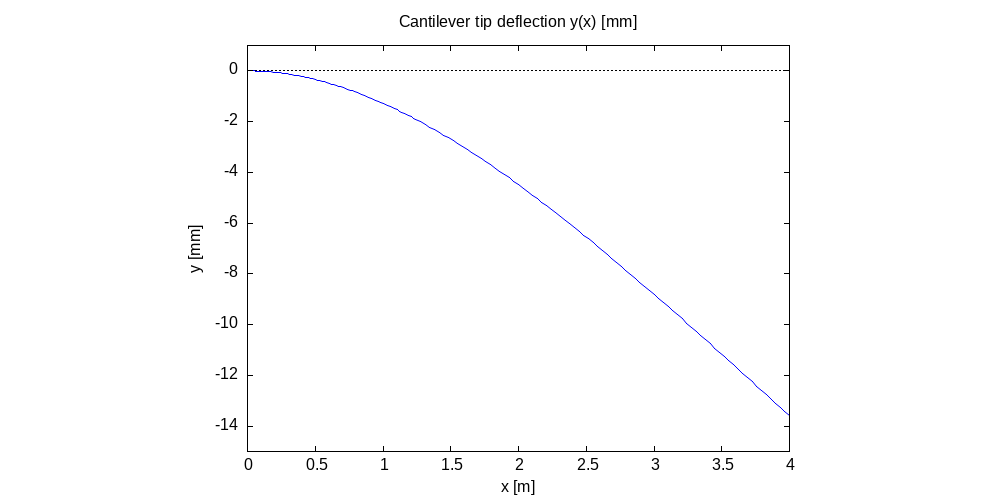

# Maxima MCP Server

[](https://github.com/nagykamel-egypt/maxima-mcp/actions/workflows/ci.yml)
[](https://github.com/nagykamel-egypt/maxima-mcp/releases/latest)
[](LICENSE)

A production-grade [Model Context Protocol](https://modelcontextprotocol.io) server for
[Maxima](https://maxima.sourceforge.io), the computer algebra system. It gives LLM clients a
stateful symbolic-math workbench: evaluation, calculus, linear algebra, plotting, full-text manual
search, and source-code inspection.

```
┌──────────────┐   stdio / Streamable HTTP   ┌──────────────────┐   framed REPL   ┌─────────┐
│ MCP client   │ ◄─────────────────────────► │  maxima-mcp      │ ◄─────────────► │ Maxima  │
│ (LLM / IDE)  │                             │  tools/resources │                 │ process │
└──────────────┘                             └──────────────────┘                 └─────────┘
                                                     │
                                        ┌────────────┴────────────┐
                                        │ HTML manual + Lisp src  │
                                        │ BM25 + symbol indexes   │
                                        └─────────────────────────┘
```

## Highlights

- **29 focused tools** covering evaluation, algebra, calculus, matrices, plotting, sessions,
  documentation, share packages and source code.
- **Persistent sessions** with process isolation, per-session queues, idle expiry, LRU eviction,
  reset and cancellation.
- **Crash-safe REPL framing** using random sentinels, so warnings, errors and multi-line output are
  attributed to the right statement.
- **Timeouts that actually stop work**: a hung evaluation kills and restarts the process instead of
  poisoning the server.
- **Offline documentation index** built from the installed `maxima-doc` HTML manual: 2,800+ symbol
  entries, BM25 search, examples and categories.
- **Offline source index** over `maxima-src` and `maxima-share`: symbol → Lisp/Maxima definition,
  regex search, package discovery.
- **PNG/SVG plotting** through Maxima's gnuplot backend, returned as native MCP image content.
- **Dual transport**: stdio for local clients, authenticated Streamable HTTP with health,
  readiness, Prometheus metrics and CORS.
- **Hardened defaults**: safe mode blocks shell/file primitives, child processes receive a
  minimal environment, request limits, rate limiting and path traversal protection.
- **TypeScript, 113 automated tests**, ESLint, Prettier, Docker images and CI.

## Engineering case studies

Three complete worked examples are available:

- **[docs/CASE_STUDY_CANTILEVER.md](docs/CASE_STUDY_CANTILEVER.md)**: preliminary design of a steel
  cantilever beam, including symbolic ODE derivation, section selection, strength/shear/deflection
  checks, and Maxima-generated diagrams.
- **[docs/CASE_STUDY_PIPE_LOOP.md](docs/CASE_STUDY_PIPE_LOOP.md)**: ASME B31.1 thermal expansion loop
  for a building heating-water riser, including code stress checks, anchor/support loads, an
  independent 2D frame verification, and a buildable recommendation.
- **[docs/CASE_STUDY_VENTILATION.md](docs/CASE_STUDY_VENTILATION.md)**: VAV supply-air duct and fan
  selection for a mid-rise office floor at altitude, including ASHRAE 62.1 ventilation, Colebrook
  duct friction, ASHRAE 90.1 fan-power compliance, duct heat gain, fan/system operating points and
  part-load energy.



## Enterprise evaluation

**[docs/REPORT_AI_VS_MAXIMA_MCP.md](docs/REPORT_AI_VS_MAXIMA_MCP.md)**: enterprise comparison of
AI-only problem solving versus AI + Maxima MCP, including technical case results, capability
scorecard, risk controls, cost model and rollout plan.

## Requirements

| Dependency                   | Notes                                                  |
| ---------------------------- | ------------------------------------------------------ |
| Node.js ≥ 20.19              | Runtime for the MCP server                             |
| Maxima ≥ 5.40                | `maxima` must be on `PATH` or set `MAXIMA_BIN`         |
| `maxima-doc`                 | Recommended: enables documentation tools and resources |
| `maxima-src`, `maxima-share` | Recommended: enables source/package tools              |
| gnuplot                      | Required only for `maxima_plot`                        |

On Debian/Ubuntu:

```bash
sudo apt-get install maxima maxima-doc maxima-src maxima-share gnuplot
```

The server auto-detects the newest installed Maxima tree under `/usr/share/maxima`. Both
`maxima-doc` (HTML) and `maxima-src`/`maxima-share` are optional; corresponding tools report a
clear, actionable error when unavailable.

## Quick start

### From source

```bash
git clone https://github.com/nagykamel-egypt/maxima-mcp.git
cd maxima-mcp
npm ci
npm run build
node dist/index.js
```

The default transport is stdio, so running it directly waits for an MCP client on stdin/stdout.
Logs go to stderr and never pollute the protocol channel.

### Published package

```bash
npx -y maxima-mcp
```

### GitHub release package

Download `maxima-mcp-<version>.tgz` from the
[latest release](https://github.com/nagykamel-egypt/maxima-mcp/releases/latest) and install it
globally:

```bash
npm install -g ./maxima-mcp-1.0.0.tgz
maxima-mcp --version
```

The release tarball is an npm package that contains the compiled `dist/` output.

### Docker (HTTP)

```bash
docker compose up --build
# or
docker build -t maxima-mcp .
docker run --rm -p 127.0.0.1:7331:7331 \
  -e MAXIMA_MCP_AUTH_TOKEN="$(openssl rand -hex 32)" \
  maxima-mcp
```

## MCP client configuration

> **Using an AI CLI?** See the **[AI CLI tutorial](docs/AI_CLI_TUTORIAL.md)** for step-by-step setup
> with OpenCode, Claude Code, OpenAI Codex CLI, Gemini CLI, Cursor CLI, GitHub Copilot CLI, Crush
> and generic JSON clients.

### Claude Desktop / Claude Code

`claude_desktop_config.json` (or the equivalent project `.mcp.json`):

```json
{
  "mcpServers": {
    "maxima": {
      "command": "npx",
      "args": ["-y", "maxima-mcp"]
    }
  }
}
```

From a local checkout, use an absolute path:

```json
{
  "mcpServers": {
    "maxima": {
      "command": "node",
      "args": ["/absolute/path/to/maxima-mcp/dist/index.js"],
      "env": {
        "MAXIMA_MCP_DEFAULT_TIMEOUT_MS": "60000"
      }
    }
  }
}
```

### VS Code

`.vscode/mcp.json`:

```json
{
  "servers": {
    "maxima": {
      "type": "stdio",
      "command": "npx",
      "args": ["-y", "maxima-mcp"]
    }
  }
}
```

### Cursor

`.cursor/mcp.json`:

```json
{
  "mcpServers": {
    "maxima": {
      "command": "npx",
      "args": ["-y", "maxima-mcp"]
    }
  }
}
```

### Remote / HTTP

```json
{
  "mcpServers": {
    "maxima": {
      "type": "http",
      "url": "http://127.0.0.1:7331/mcp",
      "headers": {
        "Authorization": "Bearer ${MAXIMA_MCP_AUTH_TOKEN}"
      }
    }
  }
}
```

More examples are in [`examples/`](examples). Ready-to-copy CLI configs are in
[`examples/cli/`](examples/cli), and the full walkthrough is
[`docs/AI_CLI_TUTORIAL.md`](docs/AI_CLI_TUTORIAL.md).

## Tool catalog

### Evaluation and sessions

| Tool                   | Purpose                                          |
| ---------------------- | ------------------------------------------------ |
| `maxima_eval`          | Evaluate one expression in a persistent session  |
| `maxima_batch`         | Evaluate sequential statements, preserving state |
| `maxima_session_open`  | Create/start a named session                     |
| `maxima_session_list`  | Inspect sessions, PIDs, restarts and usage       |
| `maxima_session_reset` | Discard state and restart the process            |
| `maxima_session_close` | Terminate and remove a session                   |

### Mathematics

| Tool                   | Purpose                                                 |
| ---------------------- | ------------------------------------------------------- |
| `maxima_solve`         | Symbolic equations and systems, optional floating point |
| `maxima_differentiate` | Derivatives of arbitrary order                          |
| `maxima_integrate`     | Symbolic or numeric (`quad_qags`) integration           |
| `maxima_limit`         | Two-sided and one-sided limits                          |
| `maxima_series`        | Taylor expansions                                       |
| `maxima_simplify`      | `ratsimp`, `radcan`, `trigsimp`, `factor`, `expand`, …  |
| `maxima_numeric`       | Double or arbitrary-precision `bfloat` evaluation       |
| `maxima_matrix`        | Determinant, inverse, rank, trace, eigenvalues, …       |
| `maxima_plot`          | 2D/3D PNG or SVG plots as MCP images                    |

### Documentation, source and packages

| Tool                       | Purpose                                         |
| -------------------------- | ----------------------------------------------- |
| `maxima_help`              | Official manual entry for a symbol              |
| `maxima_search_docs`       | BM25 search across the manual                   |
| `maxima_examples`          | Example blocks from the manual                  |
| `maxima_list_symbols`      | Discover documented symbols by prefix           |
| `maxima_doc_sections`      | List manual chapters/sections                   |
| `maxima_doc_read`          | Read a full manual section                      |
| `maxima_doc_categories`    | Manual categories and counts                    |
| `maxima_source`            | Find the implementation of a symbol             |
| `maxima_search_source`     | Text/regex search across Lisp and `.mac` files  |
| `maxima_list_source_files` | List indexed source files                       |
| `maxima_read_source_file`  | Read a source file                              |
| `maxima_list_packages`     | List installed share packages                   |
| `maxima_package_load`      | Load a share package by exact name              |
| `maxima_system_info`       | Health, version, config limits and index status |

### MCP resources

| URI                            | Content                      |
| ------------------------------ | ---------------------------- |
| `maxima://manual/index`        | Manual table of contents     |
| `maxima://manual/categories`   | Documentation categories     |
| `maxima://docs/symbol/{name}`  | Manual entry for a symbol    |
| `maxima://docs/section/{file}` | Full manual section          |
| `maxima://source/{path}`       | Installed Maxima source file |

### MCP prompts

- `maxima_solve_problem` — structured problem-solving workflow.
- `maxima_explain_symbol` — grounded explanation using manual + source.
- `maxima_debug_expression` — diagnose errors and unexpected results.

## Session model

- Calls without `session_id` use the **default session** (`default` by default), which is created
  lazily.
- An explicit unknown `session_id` is created on first use, subject to `MAXIMA_MCP_MAX_SESSIONS`.
- Variables, function definitions and loaded packages persist within a session.
- Sessions are serialized internally: concurrent calls to one session queue; calls to different
  sessions run in parallel.
- Idle sessions expire after `MAXIMA_MCP_SESSION_IDLE_MS`. When the session limit is reached, the
  least-recently-used idle session is evicted.
- A timeout, cancellation, crash or output-limit violation terminates the Maxima process. The next
  call starts a fresh process; results report `restarted: true` and previously defined state is
  lost. Use `maxima_session_reset` when starting unrelated work.

## Configuration

All configuration is through environment variables. Invalid values fail fast at startup.

| Variable                          | Default                          | Description                                            |
| --------------------------------- | -------------------------------- | ------------------------------------------------------ |
| `MAXIMA_MCP_TRANSPORT`            | `stdio`                          | `stdio` or `http`                                      |
| `MAXIMA_BIN`                      | `maxima`                         | Maxima executable                                      |
| `MAXIMA_MCP_EXTRA_ARGS`           | —                                | Extra Maxima CLI arguments (`;;` or newline separated) |
| `MAXIMA_MCP_INIT`                 | —                                | Extra Maxima initialization statements                 |
| `MAXIMA_MCP_DEFAULT_TIMEOUT_MS`   | `30000`                          | Default evaluation timeout                             |
| `MAXIMA_MCP_MAX_TIMEOUT_MS`       | `300000`                         | Hard timeout cap                                       |
| `MAXIMA_MCP_MAX_OUTPUT_BYTES`     | `1000000`                        | Buffer limit before the process is killed              |
| `MAXIMA_MCP_MAX_MEMORY_MB`        | `0`                              | Per-process RSS ceiling; `0` disables the watchdog     |
| `MAXIMA_MCP_MAX_OUTPUT_CHARS`     | `200000`                         | Per-statement retained output                          |
| `MAXIMA_MCP_MAX_EXPRESSION_CHARS` | `100000`                         | Maximum expression length                              |
| `MAXIMA_MCP_MAX_COMMANDS`         | `50`                             | Maximum statements per batch                           |
| `MAXIMA_MCP_MAX_PLOT_BYTES`       | `10000000`                       | Maximum rendered image size                            |
| `MAXIMA_MCP_MAX_SESSIONS`         | `8`                              | Concurrent sessions (processes)                        |
| `MAXIMA_MCP_SESSION_IDLE_MS`      | `900000`                         | Idle session expiry                                    |
| `MAXIMA_MCP_DEFAULT_SESSION`      | `default`                        | Default session id                                     |
| `MAXIMA_MCP_ALLOW_DANGEROUS`      | `false`                          | Allow `system`, `load`, file primitives                |
| `MAXIMA_MCP_USERDIR`              | `<cache>/maxima-user`            | Persistent userdir for compiled packages               |
| `MAXIMA_MCP_CACHE_DIR`            | `~/.cache/maxima-mcp`            | Cache directory                                        |
| `MAXIMA_MCP_DOCS`                 | `true`                           | Enable documentation tools                             |
| `MAXIMA_MCP_DOCS_PREWARM`         | `true`                           | Build doc/source indexes in background at startup      |
| `MAXIMA_MCP_DOC_DIR`              | `/usr/share/doc/maxima-doc/html` | HTML manual directory                                  |
| `MAXIMA_MCP_SRC_DIR`              | auto-detected                    | Maxima Lisp source directory                           |
| `MAXIMA_MCP_SHARE_DIR`            | auto-detected                    | Maxima share directory                                 |
| `MAXIMA_MCP_MAX_SEARCH_RESULTS`   | `20`                             | Search result cap                                      |
| `MAXIMA_MCP_SOURCE_CACHE_BYTES`   | `67108864`                       | Source file content cache budget (`0` disables)        |
| `MAXIMA_MCP_LOG_LEVEL`            | `info`                           | `fatal`…`trace`, `silent`                              |
| `MAXIMA_MCP_LOG_FORMAT`           | `auto`                           | `json`, `pretty`, `auto`                               |
| `MAXIMA_MCP_HOST`                 | `127.0.0.1`                      | HTTP bind address                                      |
| `MAXIMA_MCP_PORT`                 | `7331`                           | HTTP port                                              |
| `MAXIMA_MCP_AUTH_TOKEN`           | —                                | Bearer token for `/mcp` and `/metrics`                 |
| `MAXIMA_MCP_CORS_ORIGINS`         | `*`                              | Comma-separated allowed origins                        |
| `MAXIMA_MCP_ALLOWED_HOSTS`        | loopback                         | Comma-separated allowed `Host` values                  |
| `MAXIMA_MCP_RATE_LIMIT`           | `120`                            | Requests per window per IP (`0` disables)              |
| `MAXIMA_MCP_RATE_WINDOW_MS`       | `60000`                          | Rate-limit window                                      |
| `MAXIMA_MCP_BODY_LIMIT`           | `2mb`                            | HTTP request body limit                                |
| `MAXIMA_MCP_JSON_RESPONSE`        | `false`                          | Return JSON instead of SSE streams                     |
| `MAXIMA_MCP_TRUST_PROXY`          | `false`                          | Trust `X-Forwarded-*` from a reverse proxy             |
| `MAXIMA_MCP_HTTP_SESSION_IDLE_MS` | `1800000`                        | Idle MCP HTTP session expiry                           |

See [`.env.example`](.env.example) for a copyable template.

## HTTP transport

Start with:

```bash
MAXIMA_MCP_TRANSPORT=http \
MAXIMA_MCP_HOST=127.0.0.1 \
MAXIMA_MCP_PORT=7331 \
MAXIMA_MCP_AUTH_TOKEN=change-me \
node dist/index.js
```

| Endpoint               | Auth    | Purpose                      |
| ---------------------- | ------- | ---------------------------- |
| `POST/GET/DELETE /mcp` | Bearer  | Streamable HTTP MCP endpoint |
| `GET /healthz`         | no      | Liveness                     |
| `GET /readyz`          | no      | Readiness (Maxima available) |
| `GET /metrics`         | Bearer* | Prometheus metrics           |
| `GET /`                | no      | Server metadata              |

\* Bearer authentication is enforced on `/metrics` only when `MAXIMA_MCP_AUTH_TOKEN` is set.

Metrics include tool calls, tool latency, evaluation counts/latency, open sessions and busy
sessions in Prometheus text format.

## Security

Safe mode is **on by default** and blocks `system`, `run`, `load`, `save`, `writefile`, `read`,
`eval_string`, `:lisp`, gnuplot output/preamble options and similar primitives. Dedicated tools
(`maxima_package_load`, `maxima_plot`) provide vetted alternatives.

Safe mode is a defense-in-depth measure, **not a sandbox**. Maxima is a Turing-complete language
and the MCP server executes expressions by design. If you accept untrusted users, run the server in
a container/VM with no credentials, a read-only filesystem where possible, and CPU/memory limits.
The child Maxima process receives a minimal environment (no bearer tokens or cloud credentials).

See [`docs/SECURITY.md`](docs/SECURITY.md) for the full threat model and deployment checklist.

## Development

```bash
npm ci
npm run typecheck
npm run lint
npm test
npm run build
```

Useful scripts:

| Script                     | Description                                         |
| -------------------------- | --------------------------------------------------- |
| `npm run dev`              | Run with `tsx watch` on stdio                       |
| `npm run test:unit`        | Unit tests only                                     |
| `npm run test:integration` | Tests against real Maxima, docs, source and gnuplot |
| `npm run format`           | Prettier                                            |
| `npm run build`            | Compile to `dist/`                                  |

Integration tests automatically skip when Maxima, `maxima-doc`, `maxima-src` or gnuplot are not
installed.

Repository layout:

```
src/
  index.ts            CLI entrypoint (stdio/http)
  server.ts           MCP server factory + instructions
  http.ts             Streamable HTTP, auth, health, metrics, sessions
  runtime.ts          Shared runtime (sessions, docs, source, metrics)
  config.ts           Zod-validated environment configuration
  maxima/             process framing, sessions, output, plotting
  docs/               HTML manual index, BM25 search, source index
  tools/              tool registrations by domain
  resources.ts        MCP resources
  prompts.ts          MCP prompts
test/
  unit/               pure logic
  integration/        real Maxima / docs / source / HTTP
```

See [`docs/ARCHITECTURE.md`](docs/ARCHITECTURE.md) for internals.

## Troubleshooting

| Symptom                                  | Fix                                                                              |
| ---------------------------------------- | -------------------------------------------------------------------------------- |
| `MAXIMA_NOT_FOUND`                       | Install Maxima or set `MAXIMA_BIN` to an absolute path                           |
| Docs tools return `DOCS_UNAVAILABLE`     | Install `maxima-doc`, set `MAXIMA_MCP_DOC_DIR`                                   |
| Source tools return `SOURCE_UNAVAILABLE` | Install `maxima-src`/`maxima-share` or set directories                           |
| `MAXIMA_TIMEOUT`                         | Raise `timeout_ms`, simplify the problem, or increase limits                     |
| Plot fails                               | Install gnuplot and verify `plot2d` works in a terminal Maxima                   |
| First `maxima_package_load` is slow      | Share packages may compile on first use; the persistent userdir caches artifacts |
| HTTP 403                                 | Add the host to `MAXIMA_MCP_ALLOWED_HOSTS` or bind to loopback                   |
| HTTP 401                                 | Set the `Authorization: Bearer <token>` header                                   |

More detail in [`docs/TROUBLESHOOTING.md`](docs/TROUBLESHOOTING.md).

## License

MIT — see [LICENSE](LICENSE).

Maxima itself is distributed under the GNU GPL; this project only invokes it as a separate process.
