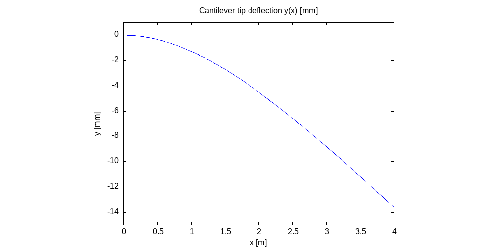
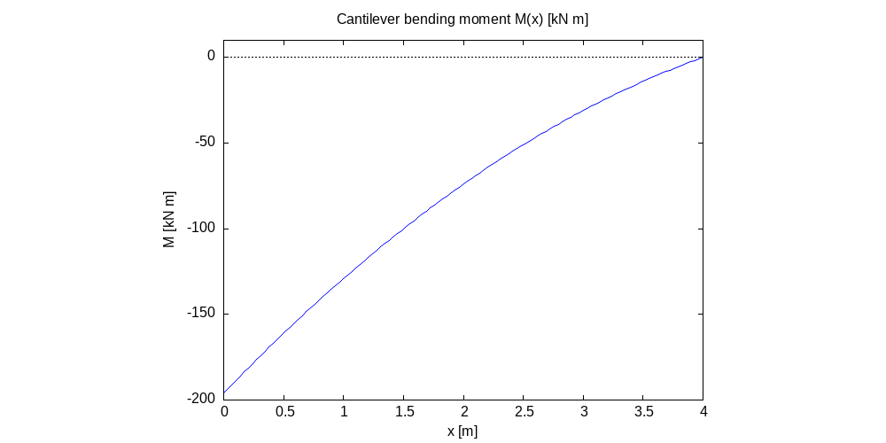

# Engineering case study: preliminary design of a steel cantilever beam

This case study shows how an engineer can use the Maxima MCP server end-to-end for a realistic
structural design problem: derive the governing equations symbolically, evaluate candidate sections,
check strength and deflection, and produce design diagrams.

> **Scope.** This is a preliminary, linear-elastic static check for illustration. It is not a
> code-compliant design. A real structure also needs load factors, lateral-torsional and local
> buckling checks, connection/weld design, fatigue, dynamics, corrosion, fire, and review by a
> licensed engineer.

---

## 1. Problem statement

A steel cantilever beam supports a canopy and suspended equipment.

| Item                                 | Value                                         |
| ------------------------------------ | --------------------------------------------- |
| Span (cantilever length)             | \(L = 4.0\ \text{m}\)                         |
| Uniform distributed load             | \(w = 12.0\ \text{kN/m}\)                     |
| Concentrated tip load                | \(P = 25.0\ \text{kN}\)                       |
| Steel modulus                        | \(E = 200\ \text{GPa}\)                       |
| Steel yield strength                 | \(F_y = 355\ \text{MPa}\) (S355)              |
| Preliminary allowable bending stress | \(\sigma_{allow} = 0.6F_y = 213\ \text{MPa}\) |
| Deflection limit                     | \(\delta_{allow} = L/250 = 16.0\ \text{mm}\)  |
| Trial section                        | IPE 300                                       |
| Candidate upgrades                   | IPE 400, IPE 450                              |

**Questions**

1. What are the maximum bending moment and shear force?
2. Does an IPE 300 section satisfy the preliminary strength and deflection checks?
3. If not, what is the lightest listed IPE section that does?
4. Show the bending-moment and deflection diagrams.

The beam is fixed at \(x=0\) and free at \(x=L\). Downward loads are positive; the bending moment is
reported as a hogging (negative) moment. Small-deflection Euler–Bernoulli beam theory is assumed.

---

## 2. Engineering model

For a cantilever with a tip load \(P\) and a uniform load \(w\), the internal moment at coordinate
\(x\) is

\[
M(x) = -P(L-x) - \frac{w}{2}(L-x)^2
\]

and the Euler–Bernoulli curvature relation is

\[
EI\,\frac{d^2y}{dx^2}=M(x)
\]

with boundary conditions

\[
y(0)=0,\qquad y'(0)=0
\]

The fixed-end moment magnitude and maximum shear are

\[
M_{\max}=PL+\frac{wL^2}{2},\qquad V_{\max}=P+wL
\]

Bending stress is estimated from the elastic section modulus \(W\):

\[
\sigma_{\max}=\frac{M_{\max}}{W}
\]

and the tip deflection follows from integrating the curvature twice.

---

## 3. Step 1 — symbolic derivation with Maxima MCP

An engineer would open a Maxima session and ask the MCP server to derive the solution rather than
copying a formula from a handbook. The key MCP call is `maxima_batch`:

```json
{
  "name": "maxima_batch",
  "arguments": {
    "commands": [
      "kill(all)$",
      "assume(L>0, E>0, I>0, P>0, w>0)$",
      "ode: 'diff(y,x,2) = (-P*(L-x) - w*(L-x)^2/2)/(E*I);",
      "sol: ode2(ode, y, x);",
      "sol: ic2(sol, x=0, y=0, 'diff(y,x)=0);",
      "y_tip: factor(ratsimp(-ev(rhs(sol), x=L)));",
      "M_fixed: -ev(P*(L-x) + w*(L-x)^2/2, x=0);"
    ]
  }
}
```

Maxima returns the general solution and then the boundary-conditioned solution:

```maxima
/* general solution */
y = -((w*x^4 + (-(4*L*w)-4*P)*x^3 + (6*L^2*w+12*L*P)*x^2)/(24*E*I))
   + %k2*x + %k1

/* fixed-end boundary conditions */
y = -((w*x^4 + (-(4*L*w)-4*P)*x^3 + (6*L^2*w+12*L*P)*x^2)/(24*E*I))
```

The tip deflection magnitude is

```maxima
y_tip = (L^3*(3*L*w + 8*P))/(24*E*I)
```

Equivalently, in a more readable form:

\[
\boxed{
\delta(x)=\frac{x^2}{24EI}
\left[
6L^2w+12LP-(4Lw+4P)x+wx^2
\right]
}
\]

\[
\boxed{
\delta_{\text{tip}}=\frac{PL^3}{3EI}+\frac{wL^4}{8EI}
}
\]

This matches the standard superposition formulas, but Maxima derived it from the governing ODE and
boundary conditions.

The fixed-end moment is

```maxima
M_fixed = -(L^2*w)/2 - L*P
```

so its magnitude is

\[
\boxed{M_{\max}=PL+\frac{wL^2}{2}}
\]

---

## 4. Step 2 — numerical evaluation

Substitute the project values in SI units:

```maxima
params: [L=4, P=25000, w=12000, E=200e9]$

Mnum: float(ev(M_fixed, params));       /* -196000.0 N m */
Vmax: float(ev(P + w*L, params));       /*  73000.0 N   */

y300: float(ev(y_tip, params, I=8.356e-5));  /* 0.05489 m */
y400: float(ev(y_tip, params, I=2.313e-4));  /* 0.01983 m */
y450: float(ev(y_tip, params, I=3.374e-4));  /* 0.01359 m */
```

Results:

| Quantity                                                                    | Value                                                      |
| --------------------------------------------------------------------------- | ---------------------------------------------------------- |
| Maximum bending moment \(M_{\max}\)                                         | \(196.0\ \text{kN·m}\)                                     |
| Maximum shear \(V_{\max}\)                                                  | \(73.0\ \text{kN}\)                                        |
| Required section modulus \(W_{req}=M_{\max}/\sigma_{allow}\)                | \(920\ \text{cm}^3\)                                       |
| Required moment of inertia \(I_{req}\) for \(\delta_{allow}=16\ \text{mm}\) | \(2.867\times10^{-4}\ \text{m}^4 = 28{,}667\ \text{cm}^4\) |

The required inertia came directly from solving the symbolic tip-deflection equation:

```maxima
Ireq: float(ev(rhs(solve(y_tip = L/250, I)[1]), params));
/* 2.866666666666666E-4 m^4 */
```

---

## 5. Step 3 — section selection

Standard IPE properties used for the preliminary comparison:

| Section | \(I\) (cm⁴) | \(W\) (cm³) |
| ------- | ----------: | ----------: |
| IPE 300 |       8,356 |         557 |
| IPE 400 |      23,130 |       1,160 |
| IPE 450 |      33,740 |       1,500 |

Using the same Maxima session, evaluate stress and deflection for each candidate:

```maxima
sigma300: float(abs(Mnum)/5.57e-4)/1e6;
sigma400: float(abs(Mnum)/1.16e-3)/1e6;
sigma450: float(abs(Mnum)/1.5e-3)/1e6;

util_sigma300: sigma300/213.0;
util_sigma400: sigma400/213.0;
util_sigma450: sigma450/213.0;

util_defl300: y300/0.016;
util_defl400: y400/0.016;
util_defl450: y450/0.016;
```

| Section | \(\sigma_{\max}\) (MPa) | \(\sigma/\sigma_{allow}\) | \(\delta_{\text{tip}}\) (mm) | \(\delta/\delta_{allow}\) | Verdict                       |
| ------- | ----------------------: | ------------------------: | ---------------------------: | ------------------------: | ----------------------------- |
| IPE 300 |                   351.9 |                      1.65 |                        54.89 |                      3.43 | Fails strength and deflection |
| IPE 400 |                   169.0 |                      0.79 |                        19.83 |                      1.24 | Strength OK; deflection fails |
| IPE 450 |                   130.7 |                      0.61 |                        13.59 |                      0.85 | **Passes both**               |

The IPE 300 is close to first yield (352 MPa vs 355 MPa) and has no design margin; its deflection is
more than three times the limit. The IPE 400 resolves strength but still exceeds the deflection
limit. The **IPE 450** satisfies both preliminary checks with a 15% deflection margin and a 39%
stress margin.

---

## 6. Step 4 — shear check for the selected section

For a preliminary web-shear check, approximate the shear area as
\(A_w\approx(h-2t_f)t_w\).

```maxima
Aw450: (450 - 2*14.6)*9.4;              /* mm^2 */
tau450: float(Vmax/(Aw450*1e-6))/1e6;   /* MPa */
```

Results:

\[
A_w \approx 3{,}956\ \text{mm}^2,\qquad
\tau_{avg}\approx 18.5\ \text{MPa}
\]

With a preliminary allowable shear stress of \(0.4F_y=142\ \text{MPa}\), the shear utilization is
about \(0.13\). Web shear is not critical for this load case.

> A real design must also check shear buckling, concentrated loads, lateral-torsional buckling,
> local flange/web buckling, and the fixed-end connection.

---

## 7. Step 5 — design diagrams with `maxima_plot`

With the selected IPE 450, the deflection in millimetres is

\[
y(x)\,[\text{mm}]
= -\frac{1000}{EI}
\left[
\frac{w x^4}{24}-\frac{(4Lw+4P)x^3}{24}
+\frac{(6L^2w+12LP)x^2}{24}
\right]
\]

and the bending moment in kN·m is

\[
M(x)\,[\text{kN·m}]
= -\frac{P(L-x)+w(L-x)^2/2}{1000}
\]

The MCP call used to render the deflection diagram:

```json
{
  "name": "maxima_plot",
  "arguments": {
    "expressions": ["-1000*(12000*x^4 - 292000*x^3 + 2352000*x^2)/1.61952e9"],
    "x_min": 0,
    "x_max": 4,
    "y_min": -15,
    "y_max": 1,
    "format": "png",
    "title": "Cantilever tip deflection y(x) [mm]",
    "xlabel": "x [m]",
    "ylabel": "y [mm]",
    "grid": true,
    "legend": false
  }
}
```



A second `maxima_plot` call produced the bending-moment diagram:

```json
{
  "name": "maxima_plot",
  "arguments": {
    "expressions": ["-(25000*(4-x) + 12000*(4-x)^2/2)/1000"],
    "x_min": 0,
    "x_max": 4,
    "y_min": -200,
    "y_max": 10,
    "format": "png",
    "title": "Cantilever bending moment M(x) [kN m]",
    "xlabel": "x [m]",
    "ylabel": "M [kN m]",
    "grid": true,
    "legend": false
  }
}
```



The maximum moment occurs at the fixed end and decreases to zero at the free end, as expected. The
deflection is largest at the tip and is about 13.6 mm.

---

## 8. Final recommendation

Use an **IPE 450** section in S355 steel for this preliminary load case.

| Check             | Result                                                                |
| ----------------- | --------------------------------------------------------------------- |
| Bending stress    | \(130.7\ \text{MPa} < 213\ \text{MPa}\) — OK                          |
| Tip deflection    | \(13.6\ \text{mm} < 16.0\ \text{mm}\) — OK                            |
| Average web shear | \(18.5\ \text{MPa} < 142\ \text{MPa}\) — OK                           |
| Required \(I\)    | \(28{,}667\ \text{cm}^4\); IPE 450 provides \(33{,}740\ \text{cm}^4\) |
| Required \(W\)    | \(920\ \text{cm}^3\); IPE 450 provides \(1{,}500\ \text{cm}^3\)       |

Before fabrication, the engineer must complete the code checks and connection design listed in the
scope note.

---

## 9. How the engineer used Maxima MCP

| Step                             | MCP tool                               | Why                                                           |
| -------------------------------- | -------------------------------------- | ------------------------------------------------------------- |
| Start clean and define the model | `maxima_session_reset`, `maxima_batch` | Reproducible symbolic model in one session                    |
| Solve the ODE                    | `maxima_batch` with `ode2` / `ic2`     | Derive the deflection formula and boundary conditions         |
| Check syntax                     | `maxima_help` with `ode2`, `ic2`       | Ground the commands in the installed manual                   |
| Evaluate candidates              | `maxima_batch`                         | Substitute loads and section properties, compute utilizations |
| Solve for required section       | `maxima_batch` with `solve`            | Find \(I_{req}\) from the deflection limit                    |
| Verify substitutions             | `maxima_eval` / `maxima_batch`         | Recompute moments, stresses, deflections                      |
| Produce diagrams                 | `maxima_plot`                          | Render deflection and moment diagrams as images               |
| Document assumptions             | session notes / project report         | Keep the engineering basis explicit                           |

A compact reproducible batch for the core derivation:

```maxima
kill(all)$
assume(L>0, E>0, I>0, P>0, w>0)$

ode: 'diff(y,x,2) = (-P*(L-x) - w*(L-x)^2/2)/(E*I)$
sol: ode2(ode, y, x)$
sol: ic2(sol, x=0, y=0, 'diff(y,x)=0)$

y_tip: factor(ratsimp(-ev(rhs(sol), x=L)));
M_fixed: -ev(P*(L-x) + w*(L-x)^2/2, x=0);

params: [L=4, P=25000, w=12000, E=200e9]$
Mnum: float(ev(M_fixed, params));
Vmax: float(ev(P + w*L, params));

y450: float(ev(y_tip, params, I=3.374e-4));
sigma450: float(abs(Mnum)/1.5e-3)/1e6;

Ireq: float(ev(rhs(solve(y_tip = L/250, I)[1]), params));

/* selected section checks */
float(y450*1000);          /* tip deflection in mm */
float(sigma450);           /* bending stress in MPa */
float(Ireq*1e8);           /* required I in cm^4 */
```

---

## 10. Limitations and next steps

This case study intentionally keeps the mechanics simple so the Maxima workflow is clear. A
production design should add:

1. Load combinations and partial factors from the governing code.
2. Self-weight, snow/wind/seismic or equipment dynamic factors as applicable.
3. Lateral-torsional buckling and local buckling checks.
4. Shear buckling and concentrated-load checks.
5. Connection, weld, bolt and base-plate design.
6. Fatigue and vibration assessment if the equipment is cyclic.
7. Corrosion protection, fire resistance and serviceability criteria.
8. Independent review and stamping by a qualified structural engineer.

The value of Maxima MCP here is not that it replaces engineering judgment. It makes the symbolic
model, numeric checks and diagrams **repeatable and auditable**: the engineer can see the ODE, the
boundary conditions, the substitutions, and every design utilization in one session.
