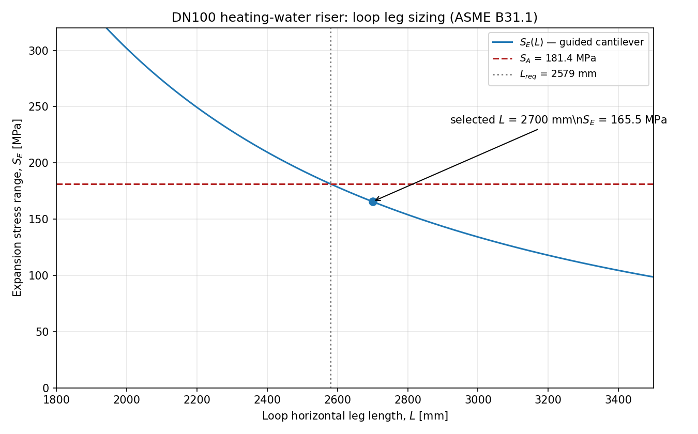

# Engineering case study: thermal expansion loop for a building heating-water riser

This case study shows a complete, realistic building-services mechanical design workflow using the
Maxima MCP server inside OpenCode. The engineer must size a thermal expansion loop for a hot-water
riser, check it against ASME B31.1, calculate anchor and support loads, verify the hand calculation
with an independent frame model, and make a buildable recommendation.

> **Scope.** This is a preliminary flexibility check for illustration. It is not a substitute for a
> formal ASME B31.1 computer stress analysis, anchor/guide design, structural review, or a licensed
> professional engineer's stamped calculation. The assumptions and limitations are stated explicitly
> so the result can be reviewed rather than blindly copied.

---

## 1. Problem statement

A 10-storey building has a DN100 Schedule 40 carbon-steel heating-water riser. The anchor-to-loop
length is 30 m, the pipe is installed at 10 °C, and it operates at 90 °C. It is fixed at the
basement and guided near the top. The plant room has a recess approximately **3.6 m wide × 2.2 m
high** in which a plain U-loop can be installed. The short upper segment above the loop is assumed
to be guided and its expansion is neglected in this preliminary model.

The contractor proposes the U-loop shown below. The engineer must answer:

1. How much does the riser grow when it reaches operating temperature?
2. What horizontal leg length \(L\) keeps the ASME B31.1 expansion stress range within the allowable?
3. Does a practical loop fit in the available recess?
4. What are the anchor, guide and support loads?
5. Is the hand calculation conservative? Verify it with an independent model.
6. What must be done before fabrication?

```text
        riser above
             │
             │
        ┌────┴────┐
        │         │
        │         │  H = 1.3 m
        │         │
        └────┬────┘
             │
        riser below

        L = 2.7 m horizontal legs
        3D bends, R = 343 mm
```

The loop is a rectangular U in the vertical plane. The left side of the rectangle is the riser; the
right side is the loop's vertical leg. The two horizontal legs absorb the vertical thermal movement;
the vertical leg is the offset that lets the loop flex.

---

## 2. Design basis

| Item                          | Value                                              |
| ----------------------------- | -------------------------------------------------- |
| Piping code                   | ASME B31.1, Chapter II (displacement stress range) |
| Pipe                          | DN100 / NPS 4, Schedule 40, ASTM A106 Grade B      |
| Outside diameter              | \(D_o = 114.3\ \text{mm}\)                         |
| Wall thickness                | \(t_n = 6.02\ \text{mm}\)                          |
| Inside diameter               | \(D_i = 102.26\ \text{mm}\)                        |
| Second moment of area         | \(I = 3.0105\times10^6\ \text{mm}^4\)              |
| Section modulus               | \(Z = 52{,}677\ \text{mm}^3\)                      |
| Metal area                    | \(A = 2{,}047.8\ \text{mm}^2\)                     |
| Young's modulus               | \(E = 200\ \text{GPa}\)                            |
| Thermal expansion coefficient | \(\alpha = 12.0\times10^{-6}\ \text{K}^{-1}\)      |
| Design pressure               | \(P = 1.0\ \text{MPa}\) gauge                      |
| Installation temperature      | \(10\ ^\circ\text{C}\)                             |
| Operating temperature         | \(90\ ^\circ\text{C}\)                             |
| Temperature range             | \(\Delta T = 80\ \text{K}\)                        |
| Anchor-to-loop length         | \(L_r = 30\ \text{m}\)                             |
| Equivalent full cycles        | \(N = 15{,}000\)                                   |
| Cold allowable stress         | \(S_c = 137.9\ \text{MPa}\)                        |
| Hot allowable stress          | \(S_h = 137.9\ \text{MPa}\)                        |
| Bend radius                   | \(R = 3D_o = 342.9\ \text{mm}\)                    |
| Insulation                    | 50 mm, 100 kg/m³, with cladding                    |

The allowable displacement stress range is

\[
S_A = f\left(1.25S_c + 0.25S_h\right),
\qquad
f = \frac{6}{N^{0.2}} \le 1.0.
\]

For \(N = 15{,}000\), \(f = 0.8769\), so

\[
S_A = 0.8769\left(1.25(137.9)+0.25(137.9)\right)
= 181.4\ \text{MPa}.
\]

The 3D bend stress intensification factor is estimated from the B31.1 elbow formula

\[
h = \frac{t_n R}{r^2},
\qquad
i = \frac{0.9}{h^{2/3}},
\qquad r = \frac{D_o}{2}.
\]

With \(R = 342.9\ \text{mm}\), \(r = 57.15\ \text{mm}\) and \(t_n = 6.02\ \text{mm}\),

\[
h = 0.6320,
\qquad
i = 1.222.
\]

A 3D bend is used deliberately: a standard long-radius bend has a smaller \(h\) and a larger SIF,
which would make the loop longer or the stress check fail.

---

## 3. Engineering model

### 3.1 Thermal growth

For a restrained-free length \(L_r\),

\[
\Delta = \alpha L_r \Delta T.
\]

\[
\Delta = (12.0\times10^{-6})(30{,}000\ \text{mm})(80\ \text{K})
= 28.8\ \text{mm}.
\]

### 3.2 U-loop as two guided cantilevers

The loop is treated as two guided cantilevers in series. Each horizontal leg absorbs half the total
movement:

\[
\delta = \frac{\Delta}{2} = 14.4\ \text{mm}.
\]

For a guided cantilever of length \(L\), the fixed-end moment is

\[
M = \frac{6EI\delta}{L^2},
\]

and the nominal bending stress is

\[
S_b = \frac{M}{Z}
= \frac{6EI\delta}{L^2}\cdot\frac{D_o}{2I}
= \frac{3ED_o\delta}{L^2}.
\]

Applying the elbow SIF gives the expansion stress range

\[
S_E = iS_b
= \frac{3iED_o\delta}{L^2}
= \frac{3iED_o\Delta}{2L^2}.
\]

The code check is

\[
S_E \le S_A.
\]

Solving for the required leg length,

\[
\boxed{
L_{\text{req}} = \sqrt{\frac{3iED_o\Delta}{2S_A}}
}
\]

or, in terms of the half-movement \(\delta\),

\[
L_{\text{req}} = \sqrt{\frac{3iED_o\delta}{S_A}}.
\]

### 3.3 Anchor force

For the pair of guided cantilevers, the conservative reaction in the direction of thermal movement is

\[
\boxed{
F = \frac{12EI\Delta}{L^3}
}.
\]

This is deliberately conservative: it treats each horizontal leg as a guided cantilever and ignores
the flexibility of the vertical leg and the elbows. The 2D frame model in Section 5 checks how
conservative it is.

### 3.4 Support spacing

ASME B31.1 Table 121.5 gives a suggested maximum span of 4.3 m for horizontal DN100 water service.
For this riser, use **4.0 m maximum support/guide spacing**. A simply supported straight-run check is

\[
M_s = \frac{wL_s^2}{8},
\qquad
S_s = \frac{M_s}{Z},
\qquad
\delta_s = \frac{5wL_s^4}{384EI}.
\]

The insulation, water and pipe weight are included in \(w\).

---

## 4. Maxima MCP solution

The engineer starts a persistent Maxima session and defines the symbolic model. The key MCP call is
`maxima_batch`, which keeps definitions between statements:

```json
{
  "name": "maxima_batch",
  "arguments": {
    "session_id": "pipe-loop-case",
    "commands": [
      "kill(all)$",
      "assume(E>0,D>0,L>0,alpha>0,L_r>0,DeltaT>0,S_A>0,i>0)$",
      "Delta : alpha*L_r*DeltaT$",
      "delta_leg : Delta/2$",
      "S_b : 3*E*D*delta_leg/L^2$",
      "S_E : i*S_b$",
      "L_req : sqrt(3*E*D*delta_leg*i/S_A)$",
      "I : %pi/64*(D^4 - (D-2*t)^4)$",
      "Z : 2*I/D$",
      "F_anchor : 12*E*I*Delta/L^3$"
    ]
  }
}
```

Maxima returns the symbolic forms:

```maxima
Delta   = DeltaT*L_r*alpha
S_b     = (3*D*DeltaT*E*L_r*alpha)/(2*L^2)
S_E     = (3*D*DeltaT*E*L_r*alpha*i)/(2*L^2)
L_req   = sqrt(3*E*D*DeltaT*L_r*alpha*i/(2*S_A))
F       = (12*DeltaT*E*I*L_r*alpha)/L^3
```

The engineer then substitutes the project values:

```maxima
params0 : [E=200000, D=114.3, t=6.02, L_r=30000,
           alpha=12e-6, DeltaT=80, S_A=181.4, i=1.222]$

Delta_num  : float(ev(Delta, params0));      /* 28.8 mm */
I_num      : float(ev(I, params0));          /* 3.0105e6 mm^4 */
Z_num      : float(ev(Z, params0));          /* 52677.5 mm^3 */
L_req_num  : float(ev(L_req, params0));      /* 2579.5 mm */

params : append(params0, [L=2700])$
S_b_num    : float(ev(S_b, params));         /* 135.47 MPa */
S_E_num    : float(ev(S_E, params));         /* 165.55 MPa */
M_num      : float(ev(6*E*I*delta_leg/L^2, params));  /* 7.136e6 N mm */
F_num      : float(ev(F_anchor, params));    /* 10571.9 N */
```

### 4.1 Results at \(L = 2.7\ \text{m}\)

| Quantity                       | Symbol              |                             Value |
| ------------------------------ | ------------------- | --------------------------------: |
| Thermal growth                 | \(\Delta\)          |                           28.8 mm |
| Movement per horizontal leg    | \(\delta=\Delta/2\) |                           14.4 mm |
| Second moment of area          | \(I\)               | \(3.0105\times10^6\ \text{mm}^4\) |
| Section modulus                | \(Z\)               |                        52,677 mm³ |
| Required leg length            | \(L_{\text{req}}\)  |                          2,579 mm |
| Selected leg length            | \(L\)               |                          2,700 mm |
| Nominal bending stress         | \(S_b\)             |                         135.5 MPa |
| Expansion stress range         | \(S_E=iS_b\)        |                         165.5 MPa |
| Allowable stress range         | \(S_A\)             |                         181.4 MPa |
| Stress utilization             | \(S_E/S_A\)         |                             0.913 |
| Fixed-end moment per leg       | \(M\)               |                         7.14 kN·m |
| Conservative vertical reaction | \(F\)               |                          10.57 kN |

The selected 2.7 m leg is **4.7% longer** than the required 2.579 m, so it passes the preliminary
B31.1 displacement-stress check. The utilization is 0.913, which is acceptable for preliminary
sizing because the hand method is conservative. Section 5 quantifies that conservatism.



The curve is plotted from the same equation evaluated in the Maxima session (and can be rendered
directly with `maxima_plot`). It shows why the 2.7 m leg is a sensible selection: the curve crosses
the allowable at about 2.58 m, and the selected point sits below the line with a small margin.

---

## 5. Independent 2D frame verification

A hand formula is useful for sizing, but a professional design should cross-check the assumed
behaviour. The engineer builds a small 2D frame model in Maxima using the direct stiffness method:

- three members: lower horizontal leg \(L\), vertical leg \(H\), upper horizontal leg \(L\);
- rigid joints, axial and bending stiffness \(EA\) and \(EI\);
- node A (basement anchor) fixed: \(u=v=\theta=0\);
- node D (top guide) guided: \(u=0\), \(\theta=0\), imposed vertical displacement \(v=\Delta\);
- nodes B and C free.

The free degrees of freedom are solved from

\[
\mathbf{K}_{ff}\mathbf{U}_f
= -\mathbf{K}_{fc}\mathbf{U}_c.
\]

The Maxima batch uses a 12×12 global stiffness matrix assembled from three 6×6 frame elements:

```maxima
k(EA,EI,l,phi):=block([c:cos(phi),s:sin(phi),kl,T],
  kl:matrix([EA/l,0,0,-EA/l,0,0],
            [0,12*EI/l^3,6*EI/l^2,0,-12*EI/l^3,6*EI/l^2],
            [0,6*EI/l^2,4*EI/l,0,-6*EI/l^2,2*EI/l],
            [-EA/l,0,0,EA/l,0,0],
            [0,-12*EI/l^3,-6*EI/l^2,0,12*EI/l^3,-6*EI/l^2],
            [0,6*EI/l^2,2*EI/l,0,-6*EI/l^2,4*EI/l]),
  T:matrix([c,s,0,0,0,0],[-s,c,0,0,0,0],[0,0,1,0,0,0],
           [0,0,0,c,s,0],[0,0,0,-s,c,0],[0,0,0,0,0,1]),
  ratsimp(transpose(T).kl.T))$

/* assemble K, partition free/constrained DOF, solve for Uf */
```

The frame results are:

| Quantity                | Hand method |  2D frame | Comment                          |
| ----------------------- | ----------: | --------: | -------------------------------- |
| Maximum moment          |   7.14 kN·m | 5.38 kN·m | Hand method is 33% conservative  |
| Nominal bending stress  |   135.5 MPa | 102.2 MPa | —                                |
| Stress with SIF         |   165.5 MPa | 124.9 MPa | —                                |
| Utilization \(S_E/S_A\) |       0.913 |     0.689 | Frame model has more margin      |
| Vertical reaction       |    10.57 kN |   3.34 kN | Hand method is 3.2× conservative |

The frame reaction is the vertical reaction at the anchor; the hand value is the conservative total
reaction for the pair of legs. The comparison is therefore conservative on the safe side.

The frame model also confirms the assumed kinematics: the far ends of the two horizontal legs move
about 14.4 mm each, so the loop really does split the 28.8 mm movement between the two legs. The
vertical leg translates and rotates with negligible axial strain, as assumed in the preliminary
model.

The difference between the two methods is useful information, not a contradiction. The hand method
assumes each horizontal leg is a guided cantilever with zero rotation at the far end. The frame
model allows the vertical leg and joints to rotate, which reduces the moments and reactions. The
hand method is therefore a conservative sizing tool. It is retained for the anchor design, while
the frame model gives confidence that the selected loop is not stress-critical.

> **Important.** The frame model is a verification, not a code compliance analysis. It uses straight
> members and rigid joints; the bend arcs are represented by the SIF, not by curved elements. It does
> not include elbow flexibility, actual SIFs, insulation, seismic, water hammer, anchor/guide
> stiffness, or thermal gradients. A formal B31.1 flexibility analysis is still required for
> construction.

---

## 6. Geometry, fit and buildability

The loop geometry is:

| Item                           |                                    Value |
| ------------------------------ | ---------------------------------------: |
| Horizontal leg length          |                   \(L = 2.70\ \text{m}\) |
| Vertical leg length            |                   \(H = 1.30\ \text{m}\) |
| Bend radius (3D)               |                  \(R = 0.343\ \text{m}\) |
| Centreline width               |             \(L + 2R = 3.386\ \text{m}\) |
| Centreline height              |             \(H + 2R = 1.986\ \text{m}\) |
| Approximate insulated envelope | \(3.55\ \text{m} \times 2.15\ \text{m}\) |
| Available recess               |   \(3.6\ \text{m} \times 2.2\ \text{m}\) |

The loop fits, but the clearances are modest. The fabricator must verify the actual bend radius,
weld preparations, insulation thickness and cladding before cutting pipe. If the recess is reduced
below about 3.55 m × 2.15 m, the loop should be re-sized or an expansion joint should be considered.

A compact decision comparison:

| Option                | Footprint                       | Anchor load                                   | Maintenance                        | Verdict                       |
| --------------------- | ------------------------------- | --------------------------------------------- | ---------------------------------- | ----------------------------- |
| U-loop, 3D bends      | ≈3.55 m × 2.15 m                | 10.6 kN (conservative)                        | Low; no moving parts               | **Selected**                  |
| Axial bellows         | Small                           | Lower, but anchor/guide design still required | Inspection and finite fatigue life | Alternative if space is tight |
| Sliding supports only | Not applicable to a fixed riser | —                                             | Needs constant-support hangers     | Not sufficient                |

The loop is selected because it fits the recess, has no moving parts, and avoids the inspection and
replacement burden of a bellows. A bellows would be the fallback if the architectural recess cannot
be enlarged.

---

## 7. Supports, anchors and guides

### 7.1 Weight and support spacing

| Item                       |      Value |
| -------------------------- | ---------: |
| Pipe metal mass            | 16.08 kg/m |
| Water mass                 |  8.21 kg/m |
| Insulation mass            |  2.58 kg/m |
| Cladding and miscellaneous |  1.00 kg/m |
| Total mass                 | 27.87 kg/m |
| Total weight               |  273.4 N/m |
| Support span selected      |      4.0 m |
| Support load per span      |    1.09 kN |
| Bending stress at 4.0 m    |   10.4 MPa |
| Sag at 4.0 m               |    1.51 mm |

The 4.0 m spacing is below the 4.3 m B31.1 Table 121.5 value for horizontal DN100 water pipe. For a
vertical riser, use floor-level guides and supports at not more than 4.0 m, with a guide within
0.5 m of each loop bend. Supports must allow axial movement; they must not clamp the pipe.

### 7.2 Anchor and guide loads

| Load case                     |              Value | Basis                                                           |
| ----------------------------- | -----------------: | --------------------------------------------------------------- |
| Thermal reaction, hand method |  10.57 kN vertical | Conservative guided-cantilever formula                          |
| Riser weight (30 m)           |   8.20 kN vertical | Pipe + water + insulation; conservatively carried by the anchor |
| Anchor design vertical load   |           18.77 kN | Sum; specify **±20 kN**                                         |
| Anchor lateral load           |               5 kN | Friction, misalignment, seismic not included                    |
| Top guide lateral load        |               5 kN | Lateral restraint only                                          |
| Support load                  | 1.5 kN per support | 1.09 kN calculated, rounded up                                  |

The anchor should be a fixed anchor at the basement, designed for **±20 kN vertical** because the
thermal force reverses when the system cools. The top guide should restrain lateral movement but
must not prevent vertical movement. Provide a vertical support above the loop to carry the upper
riser and the loop reaction; do not rely on the loop itself as a pipe support.

The anchor concrete/steel connection, embeds and baseplate are outside this calculation and must be
designed by the structural engineer for the loads above.

---

## 8. Sustained and pressure checks

The pressure stresses are small compared with the allowable:

\[
\sigma_h = \frac{PD_o}{2t_n}
= \frac{(1.0)(114.3)}{2(6.02)}
= 9.49\ \text{MPa},
\]

\[
\sigma_l = \frac{PD_o}{4t_n}
= 4.75\ \text{MPa}.
\]

The support bending stress is 10.4 MPa. The sustained stress is therefore far below
\(S_h = 137.9\ \text{MPa}\). The thermal displacement stress range, not pressure, governs this
design.

The pipe is not in the creep range at 90 °C, and the pressure is modest. The critical checks are
therefore flexibility, anchor/guide loads, and support detailing rather than wall thickness.

---

## 9. Recommendation

Use a **DN100 Schedule 40 ASTM A106 Grade B U-loop** with:

- horizontal legs \(L = 2.70\ \text{m}\);
- vertical leg \(H = 1.30\ \text{m}\);
- 3D bends, \(R = 343\ \text{mm}\);
- approximate insulated envelope \(3.55\ \text{m} \times 2.15\ \text{m}\);
- basement anchor designed for ±20 kN vertical and 5 kN lateral;
- guides at 4.0 m maximum spacing and within 0.5 m of each loop bend;
- supports designed for 1.5 kN each, allowing axial movement.

The preliminary B31.1 check gives \(S_E = 165.5\ \text{MPa} < S_A = 181.4\ \text{MPa}\)
(utilization 0.913). The independent 2D frame check gives 124.9 MPa (utilization 0.689), confirming
that the hand method is conservative.

---

## 10. Limitations and next steps

Before fabrication, the engineer must:

1. Run a formal ASME B31.1 flexibility analysis in CAESAR II, AutoPIPE or equivalent, including
   elbow flexibility factors, actual SIFs, insulation, support friction, anchor/guide stiffness,
   seismic, water hammer and thermal gradients.
2. Verify the actual pipe route, bend radius, insulation thickness and clearances in a coordinated
   model.
3. Design the basement anchor, embeds, baseplate and concrete anchorage for the specified loads.
4. Design the guides and supports, including thermal movement directions and structural attachment.
5. Check the riser for seismic and wind loads if it is exposed or in a shaft with structural
   interaction.
6. Confirm the cycle count and fatigue life with the owner; the allowable stress range depends on
   \(N\).
7. Have a licensed professional engineer review and stamp the final calculation.

If the recess cannot accommodate the loop, the fallback is a gimbal or axial bellows expansion joint
with a vendor-certified fatigue life and a dedicated anchor/guide design. The loop remains the
preferred solution because it is maintenance-free and robust.

---

## 11. How the engineer used Maxima MCP through OpenCode

The engineer worked in an OpenCode session and used the Maxima MCP server as a persistent
calculation notebook:

| Step                         | MCP tool                                | Purpose                                             |
| ---------------------------- | --------------------------------------- | --------------------------------------------------- |
| Start a clean model          | `maxima_session_reset` / `maxima_batch` | Keep assumptions and definitions reproducible       |
| Derive the loop equations    | `maxima_batch`                          | Symbolic thermal growth, stress and required length |
| Solve for \(L_{\text{req}}\) | `maxima_batch` with `sqrt` / `solve`    | Avoid hand transposition errors                     |
| Evaluate the selected loop   | `maxima_batch`                          | Numeric stress, moment and reaction                 |
| Verify with a frame model    | `maxima_batch` with matrices            | Independent stiffness check                         |
| Check support span           | `maxima_batch`                          | Weight, moment, stress and sag                      |
| Produce the design chart     | `maxima_plot`                           | Stress versus leg length                            |
| Document assumptions         | project report                          | Auditable design basis                              |

A compact reproducible batch for the core sizing calculation:

```maxima
kill(all)$
assume(E>0, D>0, L>0, alpha>0, L_r>0, DeltaT>0, S_A>0, i>0)$

Delta      : alpha*L_r*DeltaT$
delta_leg  : Delta/2$
S_b        : 3*E*D*delta_leg/L^2$
S_E        : i*S_b$
L_req      : sqrt(3*E*D*delta_leg*i/S_A)$
I          : %pi/64*(D^4 - (D-2*t)^4)$
Z          : 2*I/D$
F_anchor   : 12*E*I*Delta/L^3$

params0 : [E=200000, D=114.3, t=6.02, L_r=30000,
           alpha=12e-6, DeltaT=80, S_A=181.4, i=1.222]$

Delta_num : float(ev(Delta, params0));
I_num     : float(ev(I, params0));
Z_num     : float(ev(Z, params0));
L_req_num : float(ev(L_req, params0));

params : append(params0, [L=2700])$
S_b_num : float(ev(S_b, params));
S_E_num : float(ev(S_E, params));
F_num   : float(ev(F_anchor, params));

/* selected design */
float(L_req_num);               /* 2579.5 mm */
float(S_E_num);                 /* 165.55 MPa */
float(ev(S_E/S_A, params));     /* 0.913 */
float(F_num);                   /* 10571.9 N */
```

The value of Maxima MCP here is not that it replaces engineering judgement. It makes the
assumptions, symbolic model, substitutions, code checks and independent verification **repeatable
and auditable** in one session. The engineer can see exactly where every number came from, change
one input (for example the cycle count or the bend radius), and immediately see the effect on the
design.

A complete runnable Maxima script for this case is in
**[examples/pipe-loop/design.mac](../examples/pipe-loop/design.mac)**. It reproduces the hand
calculation, the support check and the 2D frame verification from a single file.
