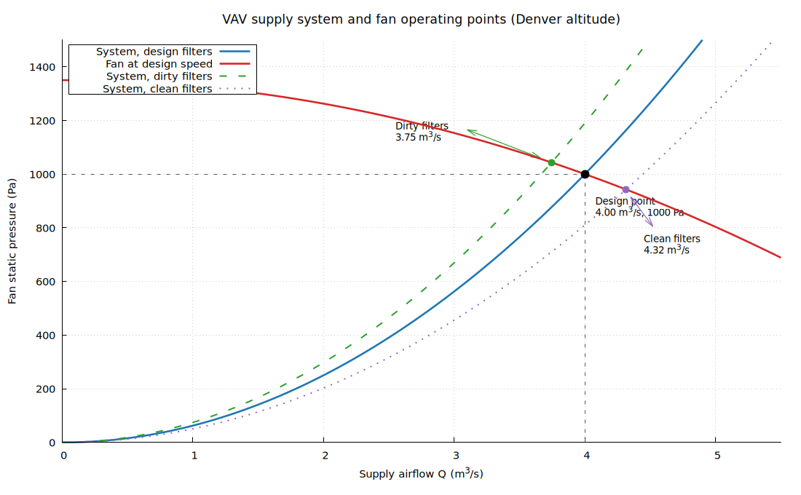
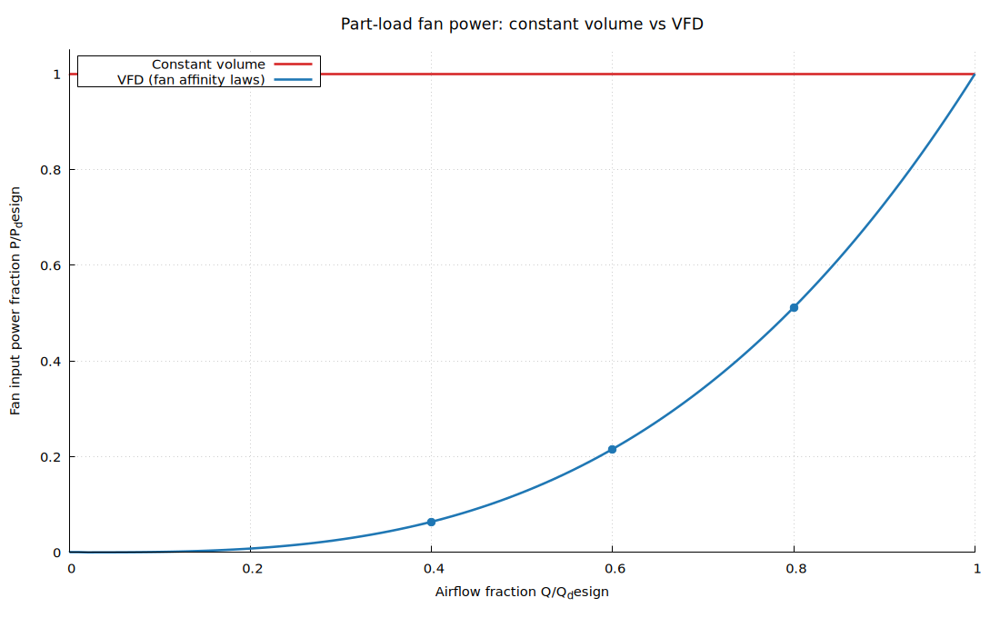

# Engineering case study: VAV supply-air duct system and fan selection for a mid-rise office floor

This case study shows a complete building-services ventilation design workflow using the Maxima MCP
server inside OpenCode. The engineer must size the supply-air ductwork for a VAV air-handling unit,
select the fan and motor at a high-altitude site, check the design against ASHRAE 62.1 ventilation
and ASHRAE 90.1 fan-power requirements, quantify duct heat gain, verify the friction calculation with
an independent correlation, and check how the fan behaves as filters load and as the VAV system moves
to part load.

> **Scope.** This is a preliminary ventilation and fan-sizing calculation for illustration. It is not
> a substitute for a stamped HVAC design, a manufacturer's certified fan selection, a full ASHRAE
> 90.1 compliance analysis, a duct acoustic analysis, or a commissioning (TAB) report. The assumptions
> and exclusions are stated explicitly so the result can be reviewed rather than copied.

---

## 1. Problem statement

A mid-rise office building in Denver, Colorado (site altitude 1,610 m) has a typical floor of
600 m² served by one variable-air-volume (VAV) rooftop air-handling unit (AHU). The floor is an
open-plan office with 60 design occupants. The architect has allocated a ceiling plenum for rectangular
galvanised-steel supply ductwork, and the contractor has proposed a single-duct VAV system with
pressure-independent terminal boxes and round flexible run-outs to diffusers.

The engineer must answer:

1. What supply airflow is required to meet the 48 kW sensible cooling load at site conditions?
2. What outdoor-air flow does ASHRAE 62.1 require, and what is the outdoor-air fraction?
3. What are the duct velocities and friction losses on the critical (index) run?
4. What fan total static pressure and shaft power are required, and what motor should be selected?
5. Does the fan comply with the ASHRAE 90.1 fan-power limitation?
6. How much heat does the supply air gain in the ceiling plenum, and does it erode the cooling capacity?
7. How does the fan operating point move as the filters load, and what is the part-load energy benefit
   of a VFD?
8. Is the friction calculation independently verifiable?

```text
        rooftop AHU
        ┌──────────┐
        │ filters  │
        │ coils    │
        │ fan + VFD│
        └────┬─────┘
             │  1200 x 600 main
             │  8 m
        ┌────┴────┐
        │         │  1100 x 600 main, 20 m
        │         ├───────────────┐
        │         │               │
        │   900 x 550, 12 m       │
        │         │               │
        │   750 x 450, 12 m       │
        │         │               │
        │   550 x 400, 9 m        │
        │         │               │
        │   VAV box + 450 mm flex │
        │         │               │
        └─────────┴───────────────┘
              ceiling diffusers

        Index run: AHU -> main -> branch -> VAV box -> diffuser
```

The duct layout is a simplified index run, not a full coordinated model. It captures the segments and
fittings that govern the fan pressure: the AHU discharge, the main trunk, one branch, the run-out, and
the terminal box.

---

## 2. Design basis

| Item                                  | Value                                                         |
| ------------------------------------- | ------------------------------------------------------------- |
| Location                              | Denver, CO, altitude 1,610 m                                  |
| Space                                 | Open-plan office, 600 m², 60 occupants                        |
| Summer design                         | 32 °C DB / 15 °C WB outdoor; 24 °C DB / 50% RH indoor         |
| Sensible cooling load                 | \(Q_s = 48.0\ \text{kW}\)                                     |
| Supply-to-room temperature difference | \(\Delta T = 12\ \text{K}\)                                   |
| Supply air temperature at diffuser    | 12 °C (coil off-coil selected for fan and duct gain)          |
| Site air density (≈15 °C)             | \(\rho = 1.0086\ \text{kg/m}^3\)                              |
| Specific heat of air                  | \(c_p = 1.005\ \text{kJ/(kg·K)}\)                             |
| Air dynamic viscosity                 | \(\mu = 1.81\times10^{-5}\ \text{Pa·s}\)                      |
| Duct material                         | Galvanised steel, \(\varepsilon = 0.09\ \text{mm}\)           |
| Duct system                           | Rectangular, SMACNA 1,000 Pa construction, insulated          |
| Terminal units                        | Pressure-independent VAV boxes, electric reheat not included  |
| Fan                                   | Centrifugal plug fan, VFD, total efficiency \(\eta_t = 0.72\) |
| Motor                                 | 4-pole induction, \(\eta_m = 0.90\)                           |
| Ventilation standard                  | ASHRAE 62.1, office default rates                             |
| Energy standard                       | ASHRAE 90.1, fan power limitation                             |
| Duct insulation                       | 50 mm, \(U \approx 0.60\ \text{W/(m}^2\text{K)}\)             |
| Ceiling-plenum temperature            | 30 °C                                                         |

Design airflow is calculated from the sensible load rather than taken from a rule of thumb. At
altitude, the lower air density means a larger volume flow is needed for the same mass flow and
cooling effect. This is the first place where a sea-level assumption produces a non-conservative
answer.

---

## 3. Engineering model

### 3.1 Supply airflow

For sensible cooling,

\[
Q_s = \dot m\,c_p\,\Delta T = \rho\,\dot V\,c_p\,\Delta T,
\]

so

\[
\dot V = \frac{Q_s}{\rho\,c_p\,\Delta T}
= \frac{48{,}000}{(1.0086)(1005)(12)}
= 3.946\ \text{m}^3/\text{s}
= 14{,}206\ \text{m}^3/\text{h}.
\]

The design airflow is rounded up to **4.00 m³/s (14,400 m³/h)** to provide a small margin.

### 3.2 Ventilation airflow (ASHRAE 62.1)

For an office, the default breathing-zone rates are \(R_p = 2.5\ \text{L/s}\) per person and
\(R_a = 0.3\ \text{L/s}\) per m². For a single-zone system with zone air-distribution effectiveness
\(E_z = 1.0\),

\[
V_{bz} = R_p P_z + R_a A_z
= (2.5)(60) + (0.3)(600)
= 330\ \text{L/s}.
\]

The outdoor-air fraction is therefore

\[
\frac{V_{oz}}{\dot V} = \frac{0.330}{3.946} = 8.36\%.
\]

The AHU must be able to deliver 330 L/s of outdoor air at design and modulate it for demand-controlled
ventilation. The economiser and outdoor-air damper must be sized for at least this flow.

### 3.3 Duct friction

For each duct segment, the hydraulic diameter is

\[
D_h = \frac{4A}{P},
\]

the mean velocity is \(V = Q/A\), and the Reynolds number is

\[
Re = \frac{\rho V D_h}{\mu}.
\]

The Darcy friction factor is obtained from the Colebrook equation

\[
\frac{1}{\sqrt f} =
-2\log_{10}\left(
\frac{\varepsilon}{3.7D_h} +
\frac{2.51}{Re\sqrt f}
\right),
\]

which is implicit in \(f\). A hand calculation would use a chart or an explicit approximation. Maxima
solves it numerically with `find_root`, so the result is repeatable and auditable. The straight-duct
pressure loss is

\[
\Delta p_f = f\frac{L}{D_h}\frac{\rho V^2}{2}.
\]

### 3.4 Fittings

Fitting losses use the local-loss coefficient \(K\):

\[
\Delta p_K = K\frac{\rho V^2}{2}.
\]

The coefficients are taken from standard fitting data for vaned rectangular elbows, transitions,
straight-through tees and wyes, and flexible-duct bends. The index run uses:

| Segment                          | Fitting allowance \(K\) |
| -------------------------------- | ----------------------: |
| AHU discharge transition + elbow |                    0.40 |
| Main trunk: elbow + straight tee |                    0.55 |
| Trunk take-off: wye + elbow      |                    0.60 |
| Branch: two elbows + wye         |                    0.85 |
| Run-out: elbow + transition      |                    0.35 |
| Flexible run-out: two bends      |                    1.20 |

Fittings, not straight duct, dominate this compact low-velocity system. That is exactly why a
"0.8 Pa/m over the duct length" rule of thumb under-predicts the fan pressure.

### 3.5 Fan total static pressure and power

The fan static pressure is the sum of the index-run duct and fitting losses, the AHU internal losses,
and the terminal losses:

\[
\Delta p_t = \Delta p_{\text{duct}} + \Delta p_{\text{AHU}} + \Delta p_{\text{terminal}}.
\]

A 10% design margin is added for ductwork tolerances, balancing dampers and unforeseen fittings. The
fan air power, shaft power and motor input are

\[
P_{\text{air}} = \dot V\,\Delta p_t,
\qquad
P_{\text{shaft}} = \frac{P_{\text{air}}}{\eta_t},
\qquad
P_{\text{input}} = \frac{P_{\text{shaft}}}{\eta_m}.
\]

### 3.6 Altitude correction to the catalog duty

Fan manufacturers publish performance at standard air density \(\rho_{std} = 1.2\ \text{kg/m}^3\).
At constant speed and volume flow, fan pressure and power scale with density. To deliver
\(\Delta p_t\) at the site density, the fan must be selected at the equivalent standard-air pressure

\[
\Delta p_{\text{catalog}} = \Delta p_t\frac{\rho_{std}}{\rho}.
\]

The site shaft power is computed with the site density; the catalog shaft power is higher. The motor
must be sized for the greater of the site duty and the catalog duty, with the manufacturer's service
factor.

### 3.7 ASHRAE 90.1 fan-power limitation

For a VAV system, the fan system input power must not exceed the allowable value. Using the SI
Option 2 limit,

\[
P_{\text{allow}} = 0.0021\,L/s_S + A,
\]

where \(L/s_S\) is the design supply airflow in L/s and \(A\) is the pressure-drop credit:

\[
A = \sum \frac{PD \times L/s_D}{650{,}000}.
\]

A MERV 13–15 final filter earns a pressure-drop credit of 0.9 in. w.g. (224 Pa). The check applies to
systems whose total fan motor nameplate exceeds 5 hp (3.7 kW); the selected 7.5 kW motor is above that
threshold.

### 3.8 Duct heat gain

The supply-air temperature rise in the ceiling plenum is

\[
Q_{\text{gain}} = U A_{\text{duct}} (T_{\text{plenum}} - T_{\text{supply}}),
\qquad
\Delta T_{\text{gain}} = \frac{Q_{\text{gain}}}{\dot m c_p}.
\]

The duct surface area is summed over the index run, including the flexible run-out. This gain does
not change the fan static pressure, but it reduces the cooling capacity delivered to the space.

### 3.9 Part-load fan energy

For a VFD-driven fan following the affinity laws at a fixed system curve,

\[
\frac{P}{P_{\text{design}}} = \left(\frac{Q}{Q_{\text{design}}}\right)^3.
\]

The annual energy is compared with a constant-volume fan running at design power for the same hours.
A real VAV system with static-pressure reset will do at least as well; the estimate is conservative.

---

## 4. Maxima MCP solution

The engineer works in a persistent Maxima session. The key MCP call is `maxima_batch`, which keeps
definitions between statements and makes the calculation reproducible.

### 4.1 Airflow and ventilation

```json
{
  "name": "maxima_batch",
  "arguments": {
    "session_id": "vent-case",
    "commands": [
      "rho : 1.0086$ cp : 1005$ Qcool : 48000$ dT : 12.0$",
      "Vdot : Qcool/(rho*cp*dT)$",
      "Vbz : 60*2.5 + 600*0.3$",
      "Vdot_vent : Vbz/1000$",
      "OA_frac : Vdot_vent/Vdot$"
    ]
  }
}
```

Maxima returns:

| Quantity                       |                    Value |
| ------------------------------ | -----------------------: |
| Site air density               |             1.0086 kg/m³ |
| Supply airflow required        | 3.946 m³/s (14,206 m³/h) |
| Ventilation airflow \(V_{bz}\) |                  330 L/s |
| Outdoor-air fraction           |                    8.36% |

### 4.2 Duct index run

The engineer defines a segment function and solves Colebrook for every segment:

```maxima
L10(x) := log(x)/log(10.0)$

fc(Re,eD) := block([f],
  f : find_root(1/sqrt(f) + 2*L10(eD/3.7 + 2.51/(Re*sqrt(f))) = 0,
                f, 1e-4, 0.2),
  f)$

segrect(Q,a,b,L,K) := block([A,P,Dh,V,Re,f,dyn,dpf,dpk],
  A:a*b, P:2*(a+b), Dh:4*A/P, V:Q/A, Re:rho*V*Dh/mu,
  f:fc(Re,eps/Dh), dyn:rho*V^2/2,
  dpf:f*L/Dh*dyn, dpk:K*dyn,
  [A,Dh,V,Re,f,dpf,dpk,dpf+dpk])$
```

The index run is evaluated segment by segment:

| Seg | Size (mm)  | \(Q\) (m³/s) | \(L\) (m) | \(\sum K\) | \(V\) (m/s) |  \(Re\) |   \(f\) | \(\Delta p\) (Pa) |
| --: | ---------- | -----------: | --------: | ---------: | ----------: | ------: | ------: | ----------------: |
|   1 | 1200 × 600 |         4.00 |         8 |       0.40 |        5.56 | 247,661 | 0.01597 |              8.71 |
|   2 | 1100 × 600 |         4.00 |        20 |       0.55 |        6.06 | 262,229 | 0.01587 |             17.76 |
|   3 | 900 × 550  |         2.75 |        12 |       0.60 |        5.56 | 211,366 | 0.01650 |             13.85 |
|   4 | 750 × 450  |         1.60 |        12 |       0.85 |        4.74 | 148,597 | 0.01761 |             13.89 |
|   5 | 550 × 400  |         0.80 |         9 |       0.35 |        3.64 |  93,851 | 0.01919 |              4.82 |
|   6 | Ø450 flex  |         0.80 |         6 |       1.20 |        5.03 | 141,899 | 0.01830 |             18.42 |

The straight-duct and fitting total is

\[
\Delta p_{\text{duct}} = 8.71 + 17.76 + 13.85 + 13.89 + 4.82 + 18.42
= 77.46\ \text{Pa}.
\]

This is a useful result in itself: for a compact, low-velocity system the ductwork is only about
77 Pa. The AHU components and the terminal unit dominate the fan duty.

### 4.3 Fan duty and ASHRAE 90.1 check

```maxima
dp_ahu  : 30+120+250+180+40+40+30$   /* 690 Pa */
dp_term : 100+40$                     /* 140 Pa */
dp_raw  : dp_duct + dp_ahu + dp_term$
dp_sys  : dp_raw*1.10$                /* 998 Pa */
dp_sel  : 1000.0$
P_air   : 4.0*dp_sel$
P_shaft : P_air/0.72$
P_input : P_shaft/0.90$
```

| Quantity                      |        Value |
| ----------------------------- | -----------: |
| Index duct + fittings         |      77.5 Pa |
| AHU internal losses           |       690 Pa |
| Terminal (VAV box + diffuser) |       140 Pa |
| Subtotal                      |     907.5 Pa |
| Design static with 10% margin |       998 Pa |
| **Selected fan static duty**  | **1,000 Pa** |
| Fan air power                 |      4.00 kW |
| Fan shaft power at site       |      5.56 kW |
| Motor input power             |      6.17 kW |
| Specific fan power            | 1.54 W/(L/s) |
| **Selected motor**            |   **7.5 kW** |

The AHU internal losses are itemised as outside-air louver 30 Pa, MERV 8 pre-filter (dirty) 120 Pa,
MERV 13 final filter (dirty) 250 Pa, cooling coil 180 Pa, heating coil 40 Pa, economiser dampers
40 Pa, and fan discharge 30 Pa.

The fan is selected at the equivalent standard-air duty:

\[
\Delta p_{\text{catalog}} = 1000\frac{1.2}{1.0086} = 1{,}190\ \text{Pa},
\qquad
P_{\text{shaft,catalog}} = \frac{4.0(1190)}{0.72} = 6.61\ \text{kW}.
\]

The site shaft power is 5.56 kW; the catalog power is 6.61 kW because the manufacturer's data are at
standard density. A 7.5 kW motor covers both with margin.

The ASHRAE 90.1 check is:

| Check                                          | Allowable |  Actual | Margin |
| ---------------------------------------------- | --------: | ------: | -----: |
| Option 1: nameplate motor power                |   9.60 kW | 7.50 kW |  21.9% |
| Option 2: fan system input with MERV 13 credit |   9.78 kW | 6.17 kW |  36.9% |

where the credit is \(A = (224.2)(4000)/650{,}000 = 1.38\ \text{kW}\) and the allowable input is
\(0.0021(4000) + 1.38 = 9.78\ \text{kW}\). The design passes both options.



The chart shows the design system curve, the fan curve at design speed, and the shift in operating
point as the filters load and as they are renewed.

---

## 5. Independent verification

### 5.1 Second friction correlation

The Colebrook equation is implicit and solved numerically. To verify it independently, the engineer
recomputes every friction factor with the explicit Swamee–Jain approximation

\[
f = \frac{0.25}{\left[\log_{10}\left(
\frac{\varepsilon}{3.7D_h} +
\frac{5.74}{Re^{0.9}}
\right)\right]^2}.
\]

| Segment | \(f\) Colebrook | \(f\) Swamee–Jain | Difference |
| ------: | --------------: | ----------------: | ---------: |
|       1 |        0.015972 |          0.015974 |     0.011% |
|       2 |        0.015867 |          0.015875 |     0.048% |
|       3 |        0.016500 |          0.016503 |     0.018% |
|       4 |        0.017607 |          0.017602 |     0.029% |
|       5 |        0.019186 |          0.019169 |     0.088% |
|       6 |        0.018297 |          0.018300 |     0.019% |

The maximum difference is **0.088%**, and the resulting duct pressure differs by **0.0025%**
(77.460 Pa vs 77.459 Pa). The friction calculation is therefore verified to well within engineering
tolerance.

### 5.2 Magnitude and unit checks

- Air power \(= 4.0\ \text{m}^3/\text{s} \times 1000\ \text{Pa} = 4.0\ \text{kW}\). At 72% fan total
  efficiency the shaft power is 5.56 kW, which is physically consistent with a large plug fan.
- Specific fan power is 1.54 W per L/s (0.73 W/cfm), a realistic value for a VAV AHU with MERV 13
  filtration.
- The 7.5 kW motor is the next standard size above the 5.56 kW site shaft power and the 6.61 kW
  catalog shaft power, with a 13% margin on the catalog value.
- The design airflow of 4.00 m³/s is 1.4% above the calculated 3.946 m³/s.

### 5.3 What is _not_ verified by this check

The independent check verifies the friction mathematics, not the engineering assumptions. The fitting
\(K\) values, the filter and coil pressure drops, the fan efficiency, the duct layout and the load
calculation must be checked against manufacturer data and the project design basis. That is a human
review responsibility, not an arithmetic one.

---

## 6. Operating points, filter loading and part-load energy

### 6.1 Fan and system interaction

The system resistance is approximated as \(\Delta p = kQ^2\) with \(k = 1000/4.0^2 = 62.5\)
Pa/(m³/s)². The fan curve at design speed is approximated as

\[
\Delta p_{\text{fan}} = 1350 - 21.875\,Q^2,
\]

which passes through the design point (4.0 m³/s, 1,000 Pa) with a shut-off pressure of 1,350 Pa.
Solving the intersection gives:

| Filter condition         | System \(k\) | Operating flow | Change from design |
| ------------------------ | -----------: | -------------: | -----------------: |
| Clean filters (−190 Pa)  |         50.6 |      4.32 m³/s |              +7.9% |
| Design (dirty)           |         62.5 |      4.00 m³/s |                 0% |
| Loaded filters (+190 Pa) |         74.4 |      3.75 m³/s |              −6.4% |

The fan curve is relatively flat, so a 190 Pa filter-loading change moves the airflow by about 6–8%.
The engineer should either specify a fan with a steeper curve, provide a balancing damper, or use
static-pressure reset and airflow measurement at the terminal boxes. The clean-filter case also
shows why the system must be balanced at start-up: airflow is almost 8% high before the filters load.

### 6.2 Part-load fan energy

A representative office load profile is 500 h at 100%, 1,000 h at 80%, 1,500 h at 60% and 1,500 h at
40% airflow, for 4,500 operating hours per year.

| Case                            | Annual fan energy |  Relative |
| ------------------------------- | ----------------: | --------: |
| Constant volume at design power |        27,778 kWh |      100% |
| VFD with affinity-law control   |         8,840 kWh |     31.8% |
| **Saving**                      |    **18,938 kWh** | **68.2%** |

At $0.12/kWh the annual saving is about **$2,273**. The VFD is therefore justified by energy alone,
and ASHRAE 90.1 requires VAV fan control in any case. A real system with static-pressure reset and a
good part-load fan curve will perform at least this well.



---

## 7. Duct heat gain and velocity check

### 7.1 Heat gain

The index-run duct surface area, including the flexible run-out, is 186.0 m². With
\(U = 0.60\ \text{W/(m}^2\text{K)}\), a 30 °C plenum and 13 °C supply air,

\[
Q_{\text{gain}} = (0.60)(186.0)(30-13) = 1{,}897\ \text{W},
\]

and the supply-air temperature rise is

\[
\Delta T_{\text{gain}} = \frac{1897}{(3.98)(1005)} = 0.47\ \text{K}.
\]

The gain is 1.90 kW, or 3.95% of the 48 kW sensible load. The coil and airflow must cover it. This is
a small but real effect that a duct-only calculation would miss; over a longer run, or with a hotter
plenum and poorer insulation, it becomes significant.

### 7.2 Velocity check

| Location         |                          Velocity | Typical ASHRAE guidance for NC-35 offices | Verdict             |
| ---------------- | --------------------------------: | ----------------------------------------: | ------------------- |
| Main trunk       |                          6.06 m/s |                                 ≤ 7.5 m/s | OK                  |
| Branch           |                          4.74 m/s |                                 ≤ 6.0 m/s | OK                  |
| Run-out          |                          3.64 m/s |                                 ≤ 4.5 m/s | OK                  |
| Flexible run-out |                          5.03 m/s |                                 ≤ 6.0 m/s | OK                  |
| Diffuser neck    | selected by diffuser manufacturer |                                 ≤ 4.0 m/s | Verify with catalog |

The 450 mm flexible duct was chosen instead of a 400 mm duct specifically to bring the velocity down
from 6.37 m/s to 5.03 m/s. This is a good example of a decision that the first-pass calculation can
expose: the smaller duct would still work hydraulically but would be noisier and would need a larger
fan pressure.

---

## 8. AI-only comparison

A representative AI-only response used sea-level density, a flat 0.8 Pa/m friction rate with a 30%
fitting allowance, and clean filters. Its reasoning was internally consistent and looked professional:

| Quantity                   |                           AI-only |                    AI + Maxima MCP |
| -------------------------- | --------------------------------: | ---------------------------------: |
| Air density                |            1.20 kg/m³ (sea level) |                1.0086 kg/m³ (site) |
| Supply airflow             |                         3.32 m³/s |                          4.00 m³/s |
| Duct + fittings            |   ≈ 70 Pa (0.8 Pa/m × 67 m × 1.3) | 77.5 Pa (Colebrook + \(K\) values) |
| AHU internals              | 500 Pa (clean filters, no margin) |             690 Pa (dirty filters) |
| Terminal                   |                            140 Pa |                             140 Pa |
| Fan static                 |                            710 Pa |                           1,000 Pa |
| Shaft power                |                           3.27 kW |                            5.56 kW |
| Motor selected             |                            4.0 kW |                             7.5 kW |
| Delivered cooling at 12 K  |                           40.3 kW |                            48.0 kW |
| Capacity shortfall         |                         **16.0%** |                               none |
| 90.1 fan-power check       |                     not performed |                passes both options |
| Duct heat gain             |                           ignored |                   1.90 kW (0.47 K) |
| Fan/system operating point |                       not checked |                  clean/dirty range |

The AI-only answer is not absurd. The 0.8 Pa/m rule is a recognised low-velocity duct rule of thumb,
and a 500 Pa AHU allowance is plausible for a clean system. The failure is cumulative:

1. **Sea-level density** understates the volume flow needed at 1,610 m by 17%. The system would deliver
   only about 40.3 kW of the required 48 kW.
2. **Clean filters** understate the AHU pressure by about 190 Pa. Dirty filters are the design case.
3. **The 0.8 Pa/m rule with a 30% fitting allowance** happened to be close (about 70 Pa vs 77.5 Pa on
   this compact run), but it was not verified and would not scale to a longer or more fitting-heavy
   system. It is not the dominant error here, but it is not a substitute for a segment-by-segment
   calculation.
4. **No altitude correction** means the fan is selected on the wrong density basis.
5. **No 90.1 check** means the engineer cannot demonstrate code compliance.
6. **No duct heat gain** overstates the net capacity delivered to the space.
7. **No system/fan interaction** means the commissioning risk from filter loading is invisible.

At the correct 4.0 m³/s duty, the AI-only 4.0 kW motor would be asked for 5.56 kW of shaft power — a
39% overload. The error would surface at commissioning as low airflow and tripped motors, after the
equipment had been ordered.

---

## 9. Recommendation

Provide one VAV rooftop AHU per typical floor with the following schedule:

| Item                 | Specification                                                                |
| -------------------- | ---------------------------------------------------------------------------- |
| Supply airflow       | 4.00 m³/s (14,400 m³/h)                                                      |
| Fan static, site     | 1,000 Pa at 1.0086 kg/m³                                                     |
| Fan catalog duty     | 4.00 m³/s at 1,190 Pa standard air                                           |
| Fan total efficiency | ≥ 72% at design                                                              |
| Motor                | 7.5 kW, premium efficiency, VFD                                              |
| Specific fan power   | 1.54 W/(L/s) at design                                                       |
| Filters              | MERV 8 pre-filter + MERV 13 final filter                                     |
| Outdoor air          | 330 L/s minimum, demand-controlled ventilation                               |
| Terminal units       | Pressure-independent VAV boxes, 100 Pa at design                             |
| Ductwork             | Rectangular galvanised steel, 1,000 Pa construction, insulated               |
| Duct leakage         | SMACNA Leakage Class 4 or better, tested                                     |
| Controls             | VAV static-pressure reset, economiser, optimum start                         |
| Commissioning        | Air balance at clean and dirty filter conditions; verify fan operating point |

The design passes the preliminary ASHRAE 90.1 fan-power check with 22% margin on Option 1 and 37% on
Option 2. The 7.5 kW motor is adequate at both site and standard-air density. The duct velocities are
within typical NC-35 guidance, and the 1.90 kW duct heat gain is covered by the coil and airflow
margin.

Before construction, the engineer must:

1. Run the manufacturer's certified fan selection at the catalog duty and confirm the fan curve,
   efficiency, sound power and non-overloading power.
2. Complete a full ASHRAE 90.1 compliance check for the adopted edition, including all fans in the
   system and any pressure-drop credits.
3. Verify the duct layout, fittings, available space and coordination with structure, sprinklers and
   other services in a 3D model.
4. Perform a duct acoustic analysis and select diffusers and terminal boxes for the required NC level.
5. Confirm the cooling load and ventilation rate with the mechanical engineer of record, including
   latent load and outdoor-air psychrometrics.
6. Check the roof structure, curb, seismic restraint, service access and condensate drainage.
7. Include filter-loading, belt/plug-fan and VFD commissioning checks in the TAB scope.
8. Have a licensed professional engineer review and stamp the final design.

The runnable calculation is in **[examples/ventilation/design.mac](../examples/ventilation/design.mac)**.
It reproduces the airflow, duct index run, fan duty, altitude correction, 90.1 check, heat gain,
operating points, verification and part-load energy from one file:

```bash
maxima -b examples/ventilation/design.mac
```

---

## 10. How the engineer used Maxima MCP through OpenCode

The engineer used the Maxima MCP server as a persistent, auditable calculation notebook:

| Step                             | MCP tool                           | Purpose                                             |
| -------------------------------- | ---------------------------------- | --------------------------------------------------- |
| Define air properties and loads  | `maxima_batch`                     | Site density, airflow, ventilation                  |
| Solve Colebrook for each segment | `maxima_batch` with `find_root`    | Implicit friction factor without charts             |
| Sum the index run                | `maxima_batch`                     | Straight duct, fittings, AHU and terminal losses    |
| Size the fan and motor           | `maxima_batch`                     | Air, shaft and input power; standard-size motor     |
| Apply the altitude correction    | `maxima_batch`                     | Catalog duty at 1.2 kg/m³                           |
| Check ASHRAE 90.1                | `maxima_batch`                     | Option 1 and Option 2 with MERV 13 credit           |
| Check duct heat gain             | `maxima_batch`                     | Surface area, \(U\), temperature rise               |
| Find operating points            | `maxima_batch` with `solve`/`sqrt` | Fan/system intersection for clean and dirty filters |
| Estimate part-load energy        | `maxima_batch`                     | Affinity laws and annual hours                      |
| Independent verification         | `maxima_batch`                     | Swamee–Jain versus Colebrook                        |
| Produce design charts            | `maxima_plot`                      | System/fan curves and part-load power               |
| Document assumptions             | project report                     | Auditable design basis                              |

### 10.1 Example OpenCode session

The engineer opens OpenCode in the project directory and asks:

> Size the supply-air index run and select the fan for the 8th-floor AHU. The site is Denver at
> 1,610 m. Use the duct layout, loads and filter schedule in the design brief.

OpenCode plans the work and calls the Maxima MCP server. The following excerpts are from the actual
session used for this case study.

**Step 1 — airflow and ventilation.** Tool call:

```json
{
  "name": "maxima_batch",
  "arguments": {
    "session_id": "vent-case",
    "commands": [
      "rho : 1.0086$ cp : 1005$ Qcool : 48000$ dT : 12.0$",
      "Vdot : Qcool/(rho*cp*dT)$",
      "Vbz : 60*2.5 + 600*0.3$",
      "print(\"Vdot [m3/s] =\", float(Vdot))$",
      "print(\"Vbz [L/s] =\", float(Vbz))$",
      "print(\"OA fraction =\", float(Vbz/1000/Vdot))$"
    ]
  }
}
```

Actual result:

```text
Vdot [m3/s] = 3.9461625049450355
Vbz [L/s] = 330.0
OA fraction = 0.0836255475
```

**Step 2 — duct index run.** The engineer defines the Colebrook and segment functions once, then
loops over the six segments. Maxima returns the friction factor and pressure loss for each segment
(the full table is in Section 4.2), ending with:

```text
Duct + flex total [Pa]: 77.45850948193558
```

**Step 3 — fan duty and ASHRAE 90.1.** Tool call:

```json
{
  "name": "maxima_batch",
  "arguments": {
    "session_id": "vent-case",
    "commands": [
      "Qd : 4.0$ dp_design : 1000.0$",
      "P_air : Qd*dp_design$ P_shaft : P_air/0.72$ P_input : P_shaft/0.90$",
      "print(\"Shaft [kW] =\", float(P_shaft/1000))$",
      "print(\"Input [kW] =\", float(P_input/1000))$",
      "print(\"Catalog duty [Pa] =\", float(dp_design*1.2/rho))$",
      "print(\"90.1 Option 2 allowable [kW] =\", float(0.0021*4000 + (0.9*249.09)*4000/650000))$"
    ]
  }
}
```

Actual result:

```text
Shaft [kW] = 5.555555555555555
Input [kW] = 6.172839506172839
Catalog duty [Pa] = 1189.767995240928
90.1 Option 2 allowable [kW] = 9.779575384615385
```

**Step 4 — design chart.** Tool call:

```json
{
  "name": "maxima_plot",
  "arguments": {
    "session_id": "vent-case",
    "expressions": ["62.5*x^2", "1350-21.875*x^2", "74.375*x^2"],
    "x_min": 0,
    "x_max": 5.5,
    "title": "VAV system resistance and fan operating points",
    "xlabel": "Airflow Q (m^3/s)",
    "ylabel": "Static pressure (Pa)"
  }
}
```

The MCP server returns the PNG shown in Section 4.3.

**Step 5 — independent verification.** The engineer re-runs the same segments with the Swamee–Jain
explicit correlation:

```text
Max friction-factor difference [%]: 0.08820498460433905
Pressure difference [%]: 0.0025450800176857366
```

The session is persistent, so changing the site altitude, the filter class or the duct size and
re-running the batch immediately updates the airflow, fan duty, 90.1 margin and energy estimate.

A compact reproducible batch for the core sizing calculation:

```maxima
kill(all)$
rho : 1.0086$ cp : 1005$ mu : 1.81e-5$ eps : 0.09e-3$
Vdot : 48000/(rho*cp*12)$
Vbz  : 60*2.5 + 600*0.3$

L10(x) := log(x)/log(10.0)$
fc(Re,eD) := block([f],
  f : find_root(1/sqrt(f) + 2*L10(eD/3.7 + 2.51/(Re*sqrt(f))) = 0,
                f, 1e-4, 0.2), f)$

/* ... segment function and index run as in Section 4.2 ... */

dp_ahu  : 30+120+250+180+40+40+30$
dp_term : 100+40$
dp_sys  : (dp_duct + dp_ahu + dp_term)*1.10$
P_air   : 4.0*1000$
P_shaft : P_air/0.72$
P_input : P_shaft/0.90$
```

The value of Maxima MCP here is not that it replaces engineering judgement. It makes the assumptions,
the implicit friction solution, the code checks, the altitude correction and the independent
verification **repeatable and auditable** in one session. The engineer can change the site altitude,
the filter class, the duct size or the fan efficiency and immediately see the effect on the fan duty,
the motor size, the 90.1 margin and the annual energy.

---

## 11. References

- ASHRAE 62.1, _Ventilation for Acceptable Indoor Air Quality_, current edition.
- ASHRAE 90.1, _Energy Standard for Sites and Buildings Except Low-Rise Residential Buildings_,
  current edition, Section 6.5.3.1 and Table 6.5.3.1-1.
- ASHRAE Handbook — _Fundamentals_, duct friction and fitting loss data.
- ASHRAE Handbook — _HVAC Systems and Equipment_, fan performance and altitude correction.
- SMACNA, _HVAC Duct Construction Standards — Metal and Flexible_, current edition.
- Colebrook, C. F. (1939). Turbulent flow in pipes, with particular reference to the transition region
  between the smooth and rough pipe laws.
- Swamee, P. K., and Jain, A. K. (1976). Explicit equations for pipe-flow problems.
- Maxima documentation, <https://maxima.sourceforge.io/documentation.html>.
- Model Context Protocol specification, <https://modelcontextprotocol.io>.
