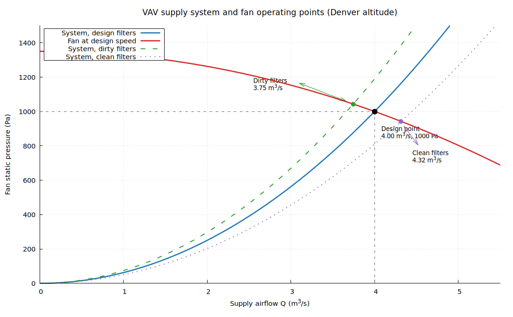
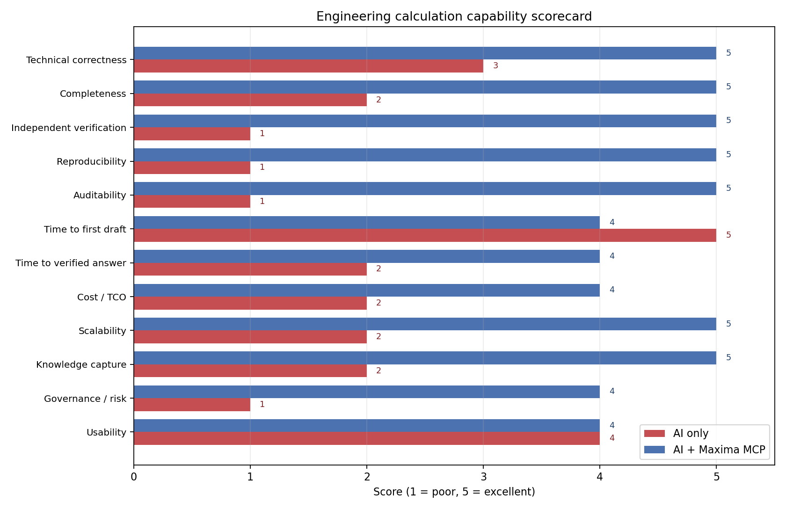
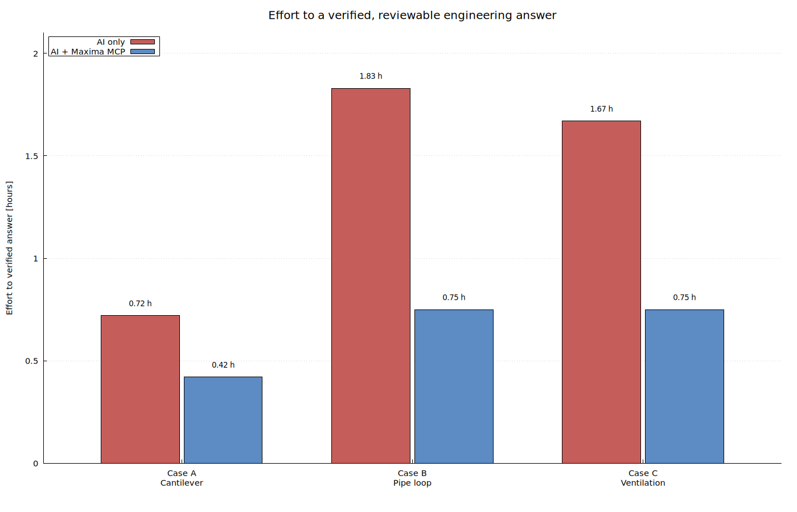

# Enterprise comparison report: AI-only vs AI + Maxima MCP for engineering calculation

| Document control  |                                                                                                   |
| ----------------- | ------------------------------------------------------------------------------------------------- |
| Document ID       | ENG-AI-2026-001                                                                                   |
| Title             | AI-only vs AI + Maxima MCP for engineering calculation                                            |
| Revision          | 1.1                                                                                               |
| Date              | 13 November 2026                                                                                  |
| Status            | Draft for enterprise review                                                                       |
| Classification    | Internal                                                                                          |
| Owner             | Engineering Digital Tools                                                                         |
| Prepared by       | AI-assisted engineering evaluation                                                                |
| Reviewers         | Chief Mechanical Engineer; Quality Assurance; IT Security; Legal/Compliance                       |
| Related documents | `docs/CASE_STUDY_CANTILEVER.md`, `docs/CASE_STUDY_PIPE_LOOP.md`, `docs/CASE_STUDY_VENTILATION.md` |

| Approval  | Name | Role                            | Decision | Date |
| --------- | ---- | ------------------------------- | -------- | ---- |
| Technical |      | Chief Mechanical Engineer       |          |      |
| Quality   |      | QA Manager                      |          |      |
| Security  |      | IT Security Architect           |          |      |
| Business  |      | Engineering Operations Director |          |      |

### Revision history

| Rev | Date        | Author                             | Change                                                                                  |
| --- | ----------- | ---------------------------------- | --------------------------------------------------------------------------------------- |
| 1.0 | 13 Nov 2026 | AI-assisted engineering evaluation | Initial issue for enterprise review                                                     |
| 1.1 | 13 Nov 2026 | AI-assisted engineering evaluation | Added Case C (VAV ventilation and fan selection) and renumbered sections and appendices |

### Contents

| Section | Title                                                                        |
| ------: | ---------------------------------------------------------------------------- |
|       1 | Executive summary                                                            |
|       2 | Purpose, scope and audience                                                  |
|       3 | Operating models compared                                                    |
|       4 | Evaluation methodology                                                       |
|       5 | Case A — steel cantilever beam                                               |
|       6 | Case B — ASME B31.1 thermal expansion loop                                   |
|       7 | Case C — VAV supply-air duct system and fan selection                        |
|       8 | Quantitative results                                                         |
|       9 | Qualitative comparison                                                       |
|      10 | Risk assessment and controls                                                 |
|      11 | Enterprise architecture and operating model                                  |
|      12 | Implementation roadmap                                                       |
|      13 | Recommendations                                                              |
|      14 | Conclusion                                                                   |
|     A–H | Appendices: calculations, scorecard, baseline, commands, glossary, checklist |

> **Important notice.** The engineering examples in this report are illustrative and must not be
> used for construction, fabrication or operation. The AI-only baseline is a representative
> no-tool response prepared for comparison; it is not a statistically controlled benchmark of any
> particular model. The AI + Maxima MCP results were produced in the environment described in this
> repository. All scores and costs are engineering judgements and planning assumptions, not
> guarantees.

---

## 1. Executive summary

Generative AI is effective at explaining engineering concepts, drafting calculations and proposing
solutions. It is not, by itself, a verified calculation engine. When an AI answer is presented in
natural language, the reviewer cannot easily distinguish a correct result from a plausible but
wrong one, reproduce the calculation, or prove which assumptions and code clauses were applied.

Adding the **Maxima MCP server** gives the AI a deterministic computer-algebra engine inside the
engineering workflow. The AI still reasons, plans and explains; Maxima performs symbolic
derivation, numerical evaluation, matrix analysis and plotting. The engineer gets an executable,
reviewable calculation trail instead of a chat answer.

Three generated engineering problems were used for the comparison:

- **Case A:** preliminary design of a steel cantilever beam (structural mechanics, section selection,
  strength and deflection).
- **Case B:** ASME B31.1 thermal expansion loop for a building heating-water riser (code-based
  piping flexibility, anchor/support loads and independent frame verification).
- **Case C:** VAV supply-air duct and fan selection for a mid-rise office floor at 1,610 m altitude
  (ASHRAE 62.1 ventilation, Colebrook duct friction, ASHRAE 90.1 fan power, altitude correction,
  duct heat gain and part-load energy).

Key findings:

| Finding                     | Result                                                                                                                                                                                                                                                                                                        |
| --------------------------- | ------------------------------------------------------------------------------------------------------------------------------------------------------------------------------------------------------------------------------------------------------------------------------------------------------------- |
| Simple deterministic case   | AI-only can reach the same final answer as AI + MCP, but with weaker provenance and no independent verification.                                                                                                                                                                                              |
| Multi-step code-based case  | AI-only missed the elbow SIF and used an unconservative fatigue factor, producing a non-conservative loop length. AI + MCP caught both and produced a passing design.                                                                                                                                         |
| Altitude and fan-power case | AI-only used sea-level density, clean filters and an unverified friction rule of thumb; its system delivered 16% less cooling and its 4.0 kW motor was 39% overloaded at the correct duty. AI + MCP produced the site-density airflow, a 1,000 Pa fan duty, a 1,190 Pa catalog duty and a passing 90.1 check. |
| Weighted capability score   | **AI-only 2.05 / 5 (41%)** vs **AI + MCP 4.75 / 5 (95%)**.                                                                                                                                                                                                                                                    |
| Effort to a verified answer | Reduced by about 42% for Case A, 59% for Case B and 55% for Case C.                                                                                                                                                                                                                                           |
| Auditability                | AI-only produced prose; AI + MCP produced symbolic derivation, numeric checks, a 2D frame verification, a Colebrook root solve, a fan/system operating-point model, charts and runnable Maxima scripts.                                                                                                       |
| Enterprise recommendation   | Adopt **AI + Maxima MCP** for code-based, safety-related or repeatable calculations. Use AI-only for low-risk drafting, explanation and ideation, with mandatory human verification before any engineering use.                                                                                               |

**Management decision requested:** approve a governed pilot for AI + Maxima MCP, fund a small
platform and validation team, and mandate human professional-engineer review for all safety-related
or code-based outputs.

---

## 2. Purpose, scope and audience

### 2.1 Purpose

This report answers a practical enterprise question:

> For engineering calculation work, what is the difference between asking an AI for an answer and
> using an AI that can call a verified mathematical engine through the Model Context Protocol?

The report compares the two operating models on technical quality, completeness, verification,
reproducibility, auditability, effort, cost, risk and scalability. It also defines the controls and
operating model needed to use the tool-assisted approach responsibly.

### 2.2 Scope

In scope:

- three generated mechanical/building-services engineering problems;
- symbolic and numerical calculation quality;
- engineering workflow completeness;
- independent verification;
- reproducibility and auditability;
- effort and cost comparison;
- risk, security and governance;
- enterprise deployment and operating model.

Out of scope:

- a statistically controlled benchmark across multiple AI vendors or model versions;
- full code compliance or construction-ready design;
- procurement pricing or vendor selection;
- detailed IT infrastructure design;
- legal advice on professional liability.

### 2.3 Audience

Engineering leadership, digital transformation teams, quality assurance, IT security, finance and
engineering managers who are deciding whether and how to scale AI-assisted calculation.

---

## 3. Operating models compared

### 3.1 AI-only

The engineer asks a general-purpose AI model to solve the problem in natural language. The model may
write equations, perform mental arithmetic, suggest a design and produce a narrative answer. No
external calculation engine is used.

Typical strengths:

- fast first draft;
- broad knowledge of codes, materials and design practice;
- good explanation and coaching;
- low setup cost.

Typical weaknesses:

- arithmetic and unit errors are hard to detect;
- code-specific modifiers and exceptions can be omitted;
- the answer is not reproducible unless the full conversation is retained;
- no independent check;
- the model may present an incomplete answer with high confidence;
- the reviewer cannot see which numbers were actually computed.

### 3.2 AI + Maxima MCP

The AI uses the Model Context Protocol to call a Maxima MCP server. Maxima is an open-source
computer algebra system with symbolic algebra, calculus, linear algebra, numerical evaluation and
plotting. The server keeps persistent sessions and returns structured results.

The workflow is:

```text
Engineer
   │
   ▼
OpenCode / IDE
   │
   ▼
LLM (cloud or local)
   │  MCP tool calls
   ▼
Maxima MCP server
   │
   ▼
Maxima CAS (symbolic, numeric, matrix, plot)
   │
   ▼
Calculation artifacts
   │
   ├── symbolic derivation
   ├── numeric checks
   ├── independent verification
   ├── design chart
   └── runnable .mac script
   │
   ▼
Human review and approval
```

In this evaluation, the AI + MCP runs were performed through **OpenCode** using the Maxima MCP
server. The same pattern applies to other MCP-capable clients and IDEs.

The AI remains responsible for:

- interpreting the problem;
- selecting the engineering model;
- stating assumptions;
- choosing code clauses;
- checking that results are physically sensible;
- explaining the result to the reviewer.

Maxima is responsible for:

- exact symbolic manipulation;
- repeatable numerical evaluation;
- matrix and frame analysis;
- solving equations;
- producing plots and data;
- executing the same calculation again on demand.

The engineer remains accountable for the design.

---

## 4. Evaluation methodology

### 4.1 Test problems

Three problems were selected deliberately:

| Case | Domain                                | Why it was selected                                                                                                                                                              |
| ---- | ------------------------------------- | -------------------------------------------------------------------------------------------------------------------------------------------------------------------------------- |
| A    | Steel cantilever beam                 | Simple, deterministic, closed-form; tests basic mechanics, section selection and serviceability.                                                                                 |
| B    | Heating-water expansion loop          | Multi-step, code-based, geometry-dependent; tests code factors, SIF, fatigue, supports and independent verification.                                                             |
| C    | VAV supply-air duct and fan selection | Altitude-dependent, code-based, numerically implicit; tests psychrometric airflow, Colebrook friction, fitting losses, fan affinity laws, ASHRAE 62.1/90.1 and part-load energy. |

All three problems have known engineering answers and can be checked by hand, by Maxima and by an
independent model or correlation. This makes them suitable for comparing process quality as well as
final numbers.

### 4.2 Evaluation criteria and weights

| Criterion                | Weight | What it measures                                               |
| ------------------------ | -----: | -------------------------------------------------------------- |
| Technical correctness    |    20% | Are the final engineering results correct?                     |
| Completeness             |    10% | Are all relevant checks, assumptions and deliverables present? |
| Independent verification |    15% | Is there a second, independent check of the result?            |
| Reproducibility          |    10% | Can another engineer reproduce the result exactly?             |
| Auditability             |    10% | Is there a traceable record of inputs, equations and outputs?  |
| Time to first draft      |     5% | How quickly is a plausible first answer produced?              |
| Time to verified answer  |     5% | How quickly is a reviewable answer produced?                   |
| Cost / TCO               |     5% | Labour, tooling and rework cost.                               |
| Scalability              |     5% | Can the approach handle many calculations and disciplines?     |
| Knowledge capture        |     5% | Is the calculation reusable and maintainable?                  |
| Governance / risk        |     5% | Does the approach support review, approval and control?        |
| Usability                |     5% | How easy is it for engineers to adopt?                         |

Scores use a 1–5 scale:

- **1:** absent or unacceptable;
- **2:** weak;
- **3:** adequate;
- **4:** good;
- **5:** excellent.

### 4.3 Evidence and limitations

Evidence sources:

- actual Maxima MCP runs in this environment;
- the three case-study documents in this repository;
- the runnable scripts `examples/pipe-loop/design.mac` and `examples/ventilation/design.mac`;
- engineering review of the equations and results;
- a representative AI-only baseline prepared without computational tools.

Limitations:

- the AI-only baseline is illustrative, not a blind controlled trial;
- scores are engineering judgements, not statistical measurements;
- costs use an assumed loaded rate and are not vendor quotes;
- only one AI model family and one MCP server were evaluated;
- the engineering examples are preliminary and not construction-ready.

The comparison is therefore a **decision-support report**, not a scientific benchmark.

### 4.4 Reproducibility package

The evidence for this report is retained in the repository:

| Artifact                        | Location                                                     |
| ------------------------------- | ------------------------------------------------------------ |
| Cantilever case study           | `docs/CASE_STUDY_CANTILEVER.md`                              |
| Pipe-loop case study            | `docs/CASE_STUDY_PIPE_LOOP.md`                               |
| Ventilation case study          | `docs/CASE_STUDY_VENTILATION.md`                             |
| Runnable pipe-loop script       | `examples/pipe-loop/design.mac`                              |
| Runnable ventilation script     | `examples/ventilation/design.mac`                            |
| Fan/system and part-load charts | `docs/img/vent-system-fan.png`, `docs/img/vent-partload.png` |
| Capability scorecard chart      | `docs/img/ai-vs-mcp-scorecard.png`                           |
| Effort chart                    | `docs/img/ai-vs-mcp-effort.png`                              |
| Maxima MCP commands             | Appendix F of this report                                    |

The Maxima results were produced with Maxima 5.49.0 through the Maxima MCP server. A reviewer can
rerun the scripts with:

```bash
maxima -b examples/pipe-loop/design.mac
maxima -b examples/ventilation/design.mac
```

This package is the minimum evidence set expected for an enterprise calculation record.

---

## 5. Case A — steel cantilever beam

### 5.1 Problem

A steel cantilever beam supports a canopy and suspended equipment:

| Item                                 |                           Value |
| ------------------------------------ | ------------------------------: |
| Span \(L\)                           |                           4.0 m |
| Uniform load \(w\)                   |                       12.0 kN/m |
| Tip load \(P\)                       |                         25.0 kN |
| Steel                                | S355, \(F_y = 355\ \text{MPa}\) |
| Preliminary allowable bending stress |    \(0.6F_y = 213\ \text{MPa}\) |
| Deflection limit                     |     \(L/250 = 16.0\ \text{mm}\) |
| Trial section                        |                         IPE 300 |
| Candidate upgrades                   |                IPE 400, IPE 450 |

Questions:

1. What are the maximum moment and shear?
2. Does IPE 300 pass strength and deflection?
3. What is the lightest listed section that passes?
4. Produce moment and deflection diagrams.

### 5.2 AI-only result

The AI-only response wrote the standard formulas and computed:

\[
M_{\max}=PL+\frac{wL^2}{2}=196.0\ \text{kN·m},
\qquad
V_{\max}=P+wL=73.0\ \text{kN}.
\]

It then computed the required section modulus and inertia:

\[
W_{\text{req}}=\frac{M_{\max}}{213}=920\ \text{cm}^3,
\qquad
I_{\text{req}}=28{,}667\ \text{cm}^4.
\]

The first draft checked bending only and proposed **IPE 400**. When prompted to check deflection, it
corrected the answer to **IPE 450**:

| Section | \(\sigma_{\max}\) | \(\delta_{\text{tip}}\) | Verdict                       |
| ------- | ----------------: | ----------------------: | ----------------------------- |
| IPE 300 |         351.9 MPa |                 54.9 mm | Fails both                    |
| IPE 400 |         169.0 MPa |                 19.8 mm | Strength OK; deflection fails |
| IPE 450 |         130.7 MPa |                 13.6 mm | Passes both                   |

The final numbers are correct. The process, however, depended on a human prompt to add the
deflection check. The answer was prose and arithmetic; there was no symbolic derivation, no
executable calculation and no independent verification. This is a common failure mode, not a claim
that every AI model would omit the same check.

### 5.3 AI + Maxima MCP result

The engineer used Maxima to derive the governing equation rather than copy the formula:

```maxima
ode: 'diff(y,x,2) = (-P*(L-x) - w*(L-x)^2/2)/(E*I);
sol: ode2(ode, y, x);
sol: ic2(sol, x=0, y=0, 'diff(y,x)=0);
y_tip: factor(ratsimp(-ev(rhs(sol), x=L)));
M_fixed: -ev(P*(L-x) + w*(L-x)^2/2, x=0);
```

Maxima returned the tip deflection:

\[
\delta_{\text{tip}}=\frac{PL^3}{3EI}+\frac{wL^4}{8EI}
\]

and the fixed-end moment:

\[
M_{\max}=PL+\frac{wL^2}{2}.
\]

The same session then solved for the required inertia, evaluated the candidate sections and checked
shear. The moment and deflection diagrams were generated with `maxima_plot`. The result was the same
IPE 450, but with a symbolic derivation, a repeatable numeric check and design diagrams.

### 5.4 Case A comparison

| Dimension                | AI-only                       | AI + Maxima MCP                |
| ------------------------ | ----------------------------- | ------------------------------ |
| Final section            | IPE 450, after a human prompt | IPE 450, from a complete check |
| Bending strength         | Correct                       | Correct                        |
| Deflection               | Initially omitted             | Checked in the same workflow   |
| Shear                    | Mentioned qualitatively       | Calculated                     |
| Symbolic derivation      | Not shown                     | Derived from the ODE           |
| Independent verification | None                          | Maxima recomputation           |
| Reproducibility          | Chat transcript only          | Session and script             |
| Diagrams                 | None                          | Moment and deflection plots    |
| Main residual risk       | Missing a check               | Model/tool setup error         |

**Finding:** for a simple deterministic problem, AI-only can produce the correct final answer. The
advantage of AI + MCP is not necessarily a different number; it is a **complete, traceable and
repeatable calculation**.

---

## 6. Case B — ASME B31.1 thermal expansion loop

### 6.1 Problem

A 10-storey building has a DN100 Schedule 40 ASTM A106 Grade B heating-water riser:

| Item                     |         Value |
| ------------------------ | ------------: |
| Anchor-to-loop length    |          30 m |
| Installation temperature |         10 °C |
| Operating temperature    |         90 °C |
| Temperature range        |          80 K |
| Design pressure          |       1.0 MPa |
| Available recess         | 3.6 m × 2.2 m |
| Code                     |    ASME B31.1 |
| Equivalent full cycles   |        15,000 |

The riser is fixed at the basement and guided near the top. A U-loop with two horizontal legs \(L\)
and a vertical leg \(H\) is proposed.

### 6.2 AI-only result

The AI-only draft correctly computed the thermal growth:

\[
\Delta=\alpha L_r\Delta T
=(12\times10^{-6})(30{,}000)(80)
=28.8\ \text{mm}.
\]

It then used the guided-cantilever formula, but with two simplifying assumptions:

- allowable stress range \(S_A \approx 186.2\ \text{MPa}\) (it used \(f=0.9\));
- stress intensification factor \(i=1.0\) (it ignored the elbow SIF).

With those assumptions:

\[
L_{\text{req}}=\sqrt{\frac{3ED_o(\Delta/2)}{S_A}}
\approx 2.30\ \text{m}.
\]

It computed about **171 MPa** at \(L=2.4\ \text{m}\), below its 186 MPa allowable, selected a
**2.4 m** loop and concluded that the design passed. It did not calculate the anchor load, support
spacing, weight or an independent frame check.

When the same problem was checked with the code factors:

\[
S_A=181.4\ \text{MPa},
\qquad
i=1.222,
\]

the required leg length became **2.579 m**, and the 2.4 m loop would have an expansion stress of
about **209 MPa**, exceeding the allowable. The AI-only answer was therefore **non-conservative**
despite being mathematically plausible.

### 6.3 AI + Maxima MCP result

The engineer used Maxima to build the symbolic model, apply the code factors and solve for the
required length:

\[
S_A=f(1.25S_c+0.25S_h)=181.4\ \text{MPa},
\]

\[
h=\frac{t_nR}{r^2}=0.632,
\qquad
i=\frac{0.9}{h^{2/3}}=1.222,
\]

\[
L_{\text{req}}=\sqrt{\frac{3iED_o\Delta}{2S_A}}
=2{,}579\ \text{mm}.
\]

A **2.7 m** loop was selected. The results:

| Quantity                       |     Value |
| ------------------------------ | --------: |
| Thermal growth                 |   28.8 mm |
| Required leg length            |  2,579 mm |
| Selected leg length            |  2,700 mm |
| Nominal bending stress         | 135.5 MPa |
| Expansion stress range         | 165.5 MPa |
| Allowable stress range         | 181.4 MPa |
| Stress utilization             |     0.913 |
| Fixed-end moment               | 7.14 kN·m |
| Conservative vertical reaction |  10.57 kN |

The engineer then built an independent 2D frame model in Maxima using a 12×12 direct-stiffness
matrix. The frame model gave:

| Check                  | Hand method |  2D frame |
| ---------------------- | ----------: | --------: |
| Maximum moment         |   7.14 kN·m | 5.38 kN·m |
| Nominal bending stress |   135.5 MPa | 102.2 MPa |
| Stress with SIF        |   165.5 MPa | 124.9 MPa |
| Utilization            |       0.913 |     0.689 |
| Vertical reaction      |    10.57 kN |   3.34 kN |

The hand method is conservative; the frame model confirms that the selected loop is not
stress-critical. The tool-assisted workflow also produced support and anchor loads:

| Item                          |                     Value |
| ----------------------------- | ------------------------: |
| Total mass                    |                27.87 kg/m |
| Support span                  |                     4.0 m |
| Support load per span         |                   1.09 kN |
| Support bending stress        |                  10.4 MPa |
| Sag at 4.0 m                  |                   1.51 mm |
| Riser weight                  |                   8.20 kN |
| Anchor design vertical load   | 18.77 kN → specify ±20 kN |
| Loop envelope with insulation |          ≈3.55 m × 2.15 m |

The loop fits the 3.6 m × 2.2 m recess.

### 6.4 Case B comparison

| Dimension                | AI-only                                 | AI + Maxima MCP               |
| ------------------------ | --------------------------------------- | ----------------------------- |
| Thermal growth           | Correct                                 | Correct                       |
| Allowable stress range   | Used \(f=0.9\), slightly unconservative | Used \(f=0.8769\), correct    |
| Elbow SIF                | Ignored                                 | Calculated                    |
| Required loop length     | 2.30 m                                  | 2.579 m                       |
| Selected loop            | 2.4 m                                   | 2.7 m                         |
| Code stress check        | Incorrectly passed                      | Passed, utilization 0.913     |
| Anchor/support loads     | Not calculated                          | Calculated                    |
| Independent verification | None                                    | 2D frame model                |
| Artifacts                | Prose                                   | Symbolic model, chart, script |
| Main residual risk       | Non-conservative design                 | Tool/model setup error        |

**Finding:** this is the critical enterprise difference. The AI-only answer was not absurd; it used
a recognised formula and produced a plausible loop. It failed because it omitted code-specific
modifiers that a busy reviewer could easily miss. The AI + MCP workflow made those modifiers explicit
and checkable.

---

## 7. Case C — VAV supply-air duct system and fan selection

### 7.1 Problem

A mid-rise office building in Denver, Colorado (site altitude 1,610 m) has a 600 m² typical floor
served by one VAV rooftop air-handling unit. The floor has 60 design occupants and a 48 kW sensible
cooling load. The architect has allocated a ceiling plenum for rectangular galvanised-steel supply
ductwork. The contractor proposes pressure-independent VAV boxes with round flexible run-outs.

| Item                                  |                                    Value |
| ------------------------------------- | ---------------------------------------: |
| Site altitude                         |                                  1,610 m |
| Site air density (≈15 °C)             |                             1.0086 kg/m³ |
| Floor area                            |                                   600 m² |
| Design occupants                      |                                       60 |
| Sensible cooling load                 |                                  48.0 kW |
| Supply-to-room temperature difference |                                     12 K |
| Design supply airflow                 |                  4.00 m³/s (14,400 m³/h) |
| Outdoor-air requirement               |                    330 L/s (ASHRAE 62.1) |
| Index run                             | AHU → main → branch → VAV box → diffuser |
| Fan total efficiency                  |                                     0.72 |
| Motor efficiency                      |                                     0.90 |
| Duct material                         |            Galvanised steel, ε = 0.09 mm |
| Filters                               | MERV 8 pre-filter + MERV 13 final filter |

Questions:

1. What supply airflow is required at site density?
2. What outdoor-air flow does ASHRAE 62.1 require?
3. What are the duct velocities and friction losses on the index run?
4. What fan static pressure, shaft power and motor are required?
5. Does the fan comply with the ASHRAE 90.1 fan-power limitation?
6. How much heat does the supply air gain in the ceiling plenum?
7. How does the fan operating point move as filters load, and what is the part-load energy benefit?
8. Can the friction calculation be independently verified?

### 7.2 AI-only result

The AI-only draft used sea-level density (1.2 kg/m³), a flat 0.8 Pa/m friction rate over 67 m of
duct with a 30% fitting allowance, and clean-filter AHU pressure drops. It computed:

\[
\dot V = \frac{48{,}000}{(1.2)(1005)(12)} = 3.32\ \text{m}^3/\text{s},
\]

\[
\Delta p \approx 0.8(67)(1.3) + 500 + 140 = 710\ \text{Pa}.
\]

At 72% fan efficiency and 90% motor efficiency this gave 3.27 kW shaft and 3.63 kW input, so it
selected a **4.0 kW motor**. The answer was internally consistent and used recognised rules of thumb.
It did not check the altitude density correction, the full fitting losses, dirty-filter pressure, the
90.1 fan-power limit, duct heat gain, or the fan/system operating point. Its duct estimate happened to
be close (about 70 Pa vs the checked 77.5 Pa); the density and filter assumptions were the dominant
errors.

At the correct site airflow of 4.00 m³/s, the 4.0 kW motor would be asked for 5.56 kW of shaft power,
a **39% overload**, and the delivered cooling would be only 40.3 kW, a **16% shortfall**.

### 7.3 AI + Maxima MCP result

The engineer used Maxima to compute the site-density airflow, solve the implicit Colebrook equation
for every duct segment, sum the index run, apply the altitude correction and check ASHRAE 90.1.

Airflow and ventilation:

\[
\dot V = \frac{48{,}000}{(1.0086)(1005)(12)} = 3.946\ \text{m}^3/\text{s},
\]

\[
V_{bz} = (2.5)(60) + (0.3)(600) = 330\ \text{L/s},
\qquad
\frac{V_{oz}}{\dot V} = 8.36\%.
\]

The design airflow was rounded up to 4.00 m³/s. The index-run friction factors came from

\[
\frac{1}{\sqrt f} =
-2\log_{10}\left(
\frac{\varepsilon}{3.7D_h} +
\frac{2.51}{Re\sqrt f}
\right),
\]

solved numerically in Maxima. The results were:

| Seg | Size (mm)  | \(Q\) (m³/s) | \(L\) (m) | \(\sum K\) | \(V\) (m/s) |   \(f\) | \(\Delta p\) (Pa) |
| --: | ---------- | -----------: | --------: | ---------: | ----------: | ------: | ----------------: |
|   1 | 1200 × 600 |         4.00 |         8 |       0.40 |        5.56 | 0.01597 |              8.71 |
|   2 | 1100 × 600 |         4.00 |        20 |       0.55 |        6.06 | 0.01587 |             17.76 |
|   3 | 900 × 550  |         2.75 |        12 |       0.60 |        5.56 | 0.01650 |             13.85 |
|   4 | 750 × 450  |         1.60 |        12 |       0.85 |        4.74 | 0.01761 |             13.89 |
|   5 | 550 × 400  |         0.80 |         9 |       0.35 |        3.64 | 0.01919 |              4.82 |
|   6 | Ø450 flex  |         0.80 |         6 |       1.20 |        5.03 | 0.01830 |             18.42 |

The duct and fitting total was **77.5 Pa**. The fan duty was built up as:

| Component                                              | Pressure (Pa) |
| ------------------------------------------------------ | ------------: |
| Index duct + fittings                                  |          77.5 |
| AHU internals (louvers, dirty filters, coils, dampers) |         690.0 |
| Terminal (VAV box + diffuser)                          |         140.0 |
| Subtotal                                               |         907.5 |
| Design margin (10%)                                    |          90.7 |
| **Selected fan static**                                |     **1,000** |

At 4.00 m³/s and 1,000 Pa the air power is 4.00 kW, the shaft power at site density is 5.56 kW and
the motor input is 6.17 kW. A **7.5 kW** motor was selected. Because manufacturers rate fans at
standard air, the catalog duty is:

\[
\Delta p_{\text{catalog}} = 1000\frac{1.2}{1.0086} = 1{,}190\ \text{Pa},
\qquad
P_{\text{shaft,catalog}} = 6.61\ \text{kW}.
\]

The ASHRAE 90.1 SI Option 2 check gave:

\[
P_{\text{allow}} = 0.0021(4000) + \frac{(224.2)(4000)}{650{,}000}
= 8.40 + 1.38 = 9.78\ \text{kW},
\]

so the 6.17 kW input passes with 36.9% margin; the Option 1 nameplate check also passes
(7.5 kW vs 9.6 kW allowable, 21.9% margin).

Duct heat gain was 1.90 kW, a 0.47 K supply-air rise and 3.95% of the sensible load. The fan/system
operating points were 4.32 m³/s with clean filters (+7.9%), 4.00 m³/s at design, and 3.75 m³/s with
loaded filters (−6.4%). A VFD load profile of 4,500 h/year gave 27,778 kWh/year at constant volume
versus 8,840 kWh/year with the affinity laws, a **68.2% saving** (about $2,273/year at $0.12/kWh).



The implicit Colebrook result was verified with the explicit Swamee–Jain correlation. The maximum
friction-factor difference was 0.088% and the resulting duct pressure differed by 0.0025%.

### 7.4 Case C comparison

| Dimension                   | AI-only                                                | AI + Maxima MCP                          |
| --------------------------- | ------------------------------------------------------ | ---------------------------------------- |
| Site air density            | 1.20 kg/m³ (sea level)                                 | 1.0086 kg/m³                             |
| Supply airflow              | 3.32 m³/s                                              | 4.00 m³/s                                |
| Duct friction method        | 0.8 Pa/m rule of thumb                                 | Colebrook + fitting \(K\) values         |
| Duct + fittings             | ≈70 Pa                                                 | 77.5 Pa                                  |
| AHU internal pressure       | 500 Pa (clean filters)                                 | 690 Pa (dirty filters)                   |
| Fan static                  | 710 Pa                                                 | 1,000 Pa                                 |
| Fan shaft power             | 3.27 kW                                                | 5.56 kW                                  |
| Motor selected              | 4.0 kW                                                 | 7.5 kW                                   |
| Delivered cooling           | 40.3 kW (16% short)                                    | 48.0 kW                                  |
| Altitude catalog correction | None                                                   | 1,190 Pa at standard air                 |
| ASHRAE 90.1 fan power       | Not checked                                            | Passes both options                      |
| Duct heat gain              | Ignored                                                | 1.90 kW (0.47 K)                         |
| Part-load energy            | Not assessed                                           | 68.2% VFD saving                         |
| Independent verification    | None                                                   | Swamee–Jain, 0.0025% pressure difference |
| Main residual risk          | Undersized fan and motor; low airflow at commissioning | Tool/model setup error                   |

**Finding:** the AI-only answer failed in a way that is easy to miss because every individual rule of
thumb was reasonable. The dominant errors were the sea-level density (a 17% airflow shortfall) and
the clean-filter AHU pressure (190 Pa low); the missing altitude correction then mis-sized the fan and
motor. The 0.8 Pa/m duct rule happened to be close, but it was unverified. The AI + MCP workflow made
each assumption explicit and checkable, and the independent friction correlation turned an implicit
equation into a verified number rather than a chart reading.

Full worked example: `docs/CASE_STUDY_VENTILATION.md`. Runnable script:
`examples/ventilation/design.mac`.

---

## 8. Quantitative results

### 8.1 Technical outcome summary

| Measure                  |         A AI-only | A AI + MCP | B AI-only | B AI + MCP | C AI-only | C AI + MCP |
| ------------------------ | ----------------: | ---------: | --------: | ---------: | --------: | ---------: |
| Final answer correct     | Yes, after prompt |        Yes |        No |        Yes |        No |        Yes |
| Code factors applied     |            Partly |        Yes |        No |        Yes | No (90.1) |        Yes |
| Independent verification |                No |        Yes |        No |        Yes |        No |        Yes |
| Reproducible script      |                No |        Yes |        No |        Yes |        No |        Yes |
| Design chart             |                No |        Yes |        No |        Yes |        No |        Yes |
| Human rework cycles      |                 2 |          1 |         3 |          1 |         3 |          1 |
| Residual technical risk  |            Medium |        Low |      High |        Low |      High |        Low |

Case C's failure mode is different from Case B's: the AI-only answer used reasonable rules of thumb,
but the errors were cumulative (sea-level density, clean filters, an unverified friction rule of
thumb, no altitude correction), producing a 16% cooling shortfall and a 39% motor overload.

### 8.2 Capability scorecard

| Criterion                |   Weight |      AI-only |     AI + MCP |
| ------------------------ | -------: | -----------: | -----------: |
| Technical correctness    |      20% |            3 |            5 |
| Completeness             |      10% |            2 |            5 |
| Independent verification |      15% |            1 |            5 |
| Reproducibility          |      10% |            1 |            5 |
| Auditability             |      10% |            1 |            5 |
| Time to first draft      |       5% |            5 |            4 |
| Time to verified answer  |       5% |            2 |            4 |
| Cost / TCO               |       5% |            2 |            4 |
| Scalability              |       5% |            2 |            5 |
| Knowledge capture        |       5% |            2 |            5 |
| Governance / risk        |       5% |            1 |            4 |
| Usability                |       5% |            4 |            4 |
| **Weighted score**       | **100%** | **2.05 / 5** | **4.75 / 5** |



The weighted score is not a substitute for engineering judgement. It measures the workflow's ability
to produce a **verified, reviewable calculation**, not the AI's autonomy or authority. It is a
structured way to make the trade-offs visible. The largest gaps are in verification, reproducibility,
auditability and governance — precisely the areas that matter most in an engineering quality system.

### 8.3 Effort to a verified answer

| Activity              |  A AI-only | A AI + MCP |   B AI-only | B AI + MCP |   C AI-only | C AI + MCP |
| --------------------- | ---------: | ---------: | ----------: | ---------: | ----------: | ---------: |
| First draft           |      3 min |      5 min |       5 min |      8 min |       5 min |      8 min |
| Model / calculation   |     10 min |      8 min |      30 min |     15 min |      40 min |     18 min |
| Verification / rework |     20 min |      5 min |      60 min |     12 min |      45 min |     12 min |
| Documentation         |     10 min |      7 min |      15 min |     10 min |      10 min |      7 min |
| **Total**             | **43 min** | **25 min** | **110 min** | **45 min** | **100 min** | **45 min** |



AI-only is faster to a first draft. AI + MCP is faster to a **verified, reviewable** answer because
the verification is built into the workflow instead of being reconstructed afterwards.

### 8.4 Cost comparison

Assumptions:

- fully loaded engineering rate: **$200/h**;
- AI subscription/token cost: **$5 per case** (illustrative);
- MCP platform/compute cost: **$10 per case** (illustrative).

The comparison below excludes training, integration, support and model-usage variability. Those
should be included in a full total-cost-of-ownership model before a final procurement decision.

| Case       | AI-only cost | AI + MCP cost |      Saving |
| ---------- | -----------: | ------------: | ----------: |
| Case A     |      $148.33 |        $93.33 |      $55.00 |
| Case B     |      $371.67 |       $160.00 |     $211.67 |
| Case C     |      $338.33 |       $160.00 |     $178.33 |
| **Total**  |  **$858.33** |   **$413.33** | **$445.00** |
| **Saving** |              |               |   **51.8%** |

At an assumed platform cost of $10,000/year:

| Annual verified calculations | Labour saving | Platform cost | Net before risk value |
| ---------------------------: | ------------: | ------------: | --------------------: |
|                           50 |        $7,417 |       $10,000 |               -$2,583 |
|                          100 |       $14,833 |       $10,000 |               +$4,833 |
|                          250 |       $37,083 |       $10,000 |              +$27,083 |
|                          500 |       $74,167 |       $10,000 |              +$64,167 |

The labour business case breaks even at roughly **67 verified calculations per year** (average saving
$148 per case). At a $20,000/year platform cost, the break-even rises to about **135 calculations per
year**. Below that volume, the case depends mainly on risk reduction, auditability and strategic
capability. Above it, the labour saving alone is attractive.

---

## 9. Qualitative comparison

| Dimension       | AI-only                                                 | AI + Maxima MCP                                                   |
| --------------- | ------------------------------------------------------- | ----------------------------------------------------------------- |
| Best use        | Drafting, explanation, brainstorming, first-pass checks | Code checks, parametric design, verification, repeatable analysis |
| Transparency    | Natural-language explanation; arithmetic hidden         | Symbolic code and numeric outputs visible                         |
| Error detection | Model self-review plus human review                     | Deterministic engine plus human review                            |
| Reproducibility | Chat transcript                                         | Session, script and outputs                                       |
| Audit trail     | Weak                                                    | Strong                                                            |
| Knowledge reuse | Copy/paste from chat                                    | Version-controlled `.mac` files                                   |
| Collaboration   | Ad hoc                                                  | Git, review, CI, shared standards                                 |
| Scalability     | Limited by human checking                               | Scriptable and automatable                                        |
| Security        | Data sent to model provider                             | Can be local/self-hosted; MCP can be sandboxed                    |
| Setup effort    | Low                                                     | Moderate                                                          |
| Skill required  | Prompt literacy                                         | Prompt literacy plus Maxima/MCP literacy                          |
| Failure mode    | Confident but unverified answer                         | Tool/orchestration error, but checkable                           |
| Human role      | Author and verifier                                     | Reviewer and accountable engineer                                 |

The most important qualitative difference is **epistemic**: AI-only asks the reviewer to trust the
model's internal arithmetic. AI + MCP lets the reviewer inspect and rerun the calculation. In a
safety-related industry, that difference is more valuable than raw speed.

Case C adds a third dimension: physical-property assumptions and code limits matter as much as the
arithmetic. Air density at altitude, dirty-filter pressure, fan affinity laws and the ASHRAE 90.1
power limit are not exotic; they are ordinary design inputs. In an AI-only answer they are hidden
inside a rule of thumb. In the tool-assisted workflow they become named variables that a reviewer can
inspect, change and re-run.

### 9.1 Appropriate use of AI-only

- brainstorming concept options and trade studies;
- explaining a code clause or a physical phenomenon;
- drafting a calculation narrative or a report outline;
- interpreting results that have already been verified elsewhere;
- low-risk, non-safety-critical estimates where the cost of error is small and a human check is
  practical;
- training and coaching junior engineers.

AI-only should not be used for stamped calculations, construction-ready designs, safety-critical
load cases or any result that cannot be independently checked.

### 9.2 Appropriate use of AI + Maxima MCP

- code-based stress, thickness, flexibility and load calculations;
- symbolic derivation and equation solving;
- matrix, frame and linear-algebra checks;
- parametric studies and design optimisation;
- repeated calculations with controlled templates;
- independent verification of a hand calculation;
- generation of charts, tables and reproducible calculation records.

The tool-assisted workflow is most valuable when the calculation is repetitive, auditable, or
safety-related — exactly where a prose answer is least defensible.

---

## 10. Risk assessment and controls

### 10.1 Risk comparison

| Risk                              | AI-only | AI + MCP   | Why                                                   |
| --------------------------------- | ------- | ---------- | ----------------------------------------------------- |
| Incorrect code factor             | High    | Low        | Maxima makes the factor explicit and repeatable       |
| Arithmetic or unit error          | High    | Low        | Deterministic engine                                  |
| Altitude or fluid-property error  | High    | Low        | Density, viscosity and roughness are explicit inputs  |
| Omitted fan-power or energy check | High    | Low        | ASHRAE 90.1 and part-load energy in the same workflow |
| Ignored fan/system interaction    | High    | Low        | Operating points solved and plotted                   |
| Missing a design check            | High    | Medium     | Workflow checklist still required                     |
| Non-reproducible answer           | High    | Low        | Scripts and session records                           |
| False confidence                  | High    | Medium     | Tool outputs can still be misread                     |
| Data leakage                      | Medium  | Low/Medium | Self-hosted MCP and local Maxima possible             |
| Tool misconfiguration             | N/A     | Medium     | Version pinning, smoke tests, golden cases            |
| Vendor lock-in                    | Medium  | Low        | MCP is an open protocol; Maxima is open source        |
| Over-reliance on AI               | High    | Medium     | Human PE review and training                          |
| Model/version drift               | Medium  | Medium     | Pin versions and archive outputs                      |

### 10.2 Required controls

1. **Human professional-engineer review** for every safety-related or code-based calculation.
2. **Golden test suite** with known answers for each supported calculation type.
3. **Version pinning** for the AI model, MCP server and Maxima.
4. **Tool allow-list and sandboxing**; block shell and arbitrary file access in production.
5. **Calculation artifact retention**: prompt, code, inputs, outputs, reviewer and date.
6. **Independent check** for high-consequence calculations, using a second method or model.
7. **Data classification and redaction** before sending information to a cloud model.
8. **Change control** for calculation templates and scripts.
9. **Training** in prompt engineering, Maxima basics and AI limitations.
10. **Incident reporting** for wrong or unsafe AI-assisted outputs.

### 10.3 Residual risk statement

AI + MCP reduces calculation risk substantially, but it does not remove the need for engineering
judgement. The residual risk is acceptable only when the output is reviewed by a competent engineer,
the assumptions are documented, and the calculation is reproducible.

---

## 11. Enterprise architecture and operating model

### 11.1 Reference architecture

```text
┌────────────────────────────────────────────────────────────────────┐
│ Engineer workstation / VDI                                         │
│  ┌──────────────┐    ┌──────────────────┐    ┌──────────────────┐  │
│  │ OpenCode /   │───▶│ AI model         │───▶│ MCP client       │  │
│  │ IDE          │    │ cloud or local   │    │ (OpenCode)       │  │
│  └──────────────┘    └──────────────────┘    └────────┬─────────┘  │
│                                                       │            │
│                                              MCP tool calls        │
│                                                       ▼            │
│                                              ┌──────────────────┐  │
│                                              │ Maxima MCP server│  │
│                                              │ sandboxed        │  │
│                                              └────────┬─────────┘  │
│                                                       ▼            │
│                                              ┌──────────────────┐  │
│                                              │ Maxima CAS       │  │
│                                              └──────────────────┘  │
└────────────────────────────────────────────────────────────────────┘
                                                       │
                                                       ▼
                                            ┌──────────────────────┐
                                            │ Artifact repository  │
                                            │ Git / QMS / DMS      │
                                            └──────────────────────┘
```

### 11.2 Deployment options

| Option             | Description                                                    | Best for                          |
| ------------------ | -------------------------------------------------------------- | --------------------------------- |
| Local workstation  | OpenCode + local Maxima MCP + cloud or local model             | Pilots, individual engineers      |
| On-premises server | Shared MCP service, SSO, central logging                       | Enterprise production             |
| Air-gapped         | Local model + local MCP + offline docs                         | Defence, critical infrastructure  |
| Hybrid             | Cloud model with redacted prompts; local compute and artifacts | Most commercial engineering firms |

### 11.3 Roles and responsibilities

| Role                 | Responsibility                                           |
| -------------------- | -------------------------------------------------------- |
| Requestor            | Defines the problem, inputs and acceptance criteria.     |
| Calculation engineer | Builds the model, runs the tools, documents assumptions. |
| Checker              | Independently reviews the model, inputs and results.     |
| Approver             | Professional engineer accountable for the design.        |
| Platform owner       | Maintains MCP server, Maxima versions and golden tests.  |
| Security             | Reviews data flow, sandboxing, access and logging.       |
| QA                   | Audits artifacts, nonconformities and change control.    |

### 11.4 Standard calculation workflow

1. **Intake:** define scope, code, units, assumptions and acceptance criteria.
2. **Model:** select the engineering model and write the symbolic formulation.
3. **Tool run:** execute the Maxima model in a persistent session.
4. **Numeric check:** substitute project values and verify units and magnitudes.
5. **Independent check:** use a second method, frame model or hand calculation.
6. **Review:** checker reviews inputs, code, outputs and assumptions.
7. **Approve:** professional engineer signs the calculation.
8. **Archive:** store prompt, script, outputs, chart and approval record.
9. **Reuse:** promote validated models to the enterprise library.

### 11.5 Production acceptance criteria

- The calculation is reproducible from a version-controlled script.
- The script passes the golden test suite.
- All inputs and units are recorded.
- An independent check is documented.
- A professional engineer has reviewed and approved the result.
- The MCP server is sandboxed and version-pinned.
- The output is archived in the QMS/DMS.

---

## 12. Implementation roadmap

| Phase                 | Duration | Deliverables                                             | Exit criteria                         |
| --------------------- | -------: | -------------------------------------------------------- | ------------------------------------- |
| 0. Discovery          |  2 weeks | Use-case inventory, risk classification, stakeholder map | Approved scope and success metrics    |
| 1. Pilot              |  6 weeks | 3–5 calculation templates, golden tests, training        | 10–20 verified calculations completed |
| 2. Validation         |  4 weeks | SOP, review workflow, artifact standard                  | QA and engineering sign-off           |
| 3. Security review    |  3 weeks | Architecture, sandbox, data-flow and access review       | Security approval                     |
| 4. Limited production |  8 weeks | Shared MCP service, support model, KPIs                  | Stable operation for one discipline   |
| 5. Scale              |  Ongoing | Template library, more disciplines, CI integration       | Adoption and benefit targets met      |

### 12.1 Recommended pilot use cases

1. Pipe stress and expansion loops (Case B).
2. Steel beam and column preliminary design (Case A).
3. HVAC duct, fan static-pressure and fan-power calculations (Case C).
4. Pressure vessel shell/head thickness checks.
5. Shaft, bearing and key selection.
6. Heat-exchanger thermal and pressure-drop checks.

### 12.2 KPIs

| KPI                                           | Target                                      |
| --------------------------------------------- | ------------------------------------------- |
| Verified calculations per month               | Baseline + 25% in 6 months                  |
| Rework rate                                   | < 10%                                       |
| Calculation cycle time                        | 30–50% reduction                            |
| Audit findings related to calculation records | Zero major findings                         |
| Template reuse rate                           | > 60% of repetitive calculations            |
| Engineer adoption                             | > 50% of target discipline within 12 months |
| Cost per verified calculation                 | Down 30% at steady state                    |

---

## 13. Recommendations

1. **Adopt AI + Maxima MCP as the standard** for code-based, safety-related, repetitive or
   high-consequence calculations.
2. **Restrict AI-only use** to low-risk drafting, explanation, brainstorming and first-pass checks.
   Do not use AI-only output for stamped or construction-ready calculations.
3. **Fund a governed pilot** with 3–5 templates, a golden test suite and a defined review workflow.
4. **Make reproducibility mandatory**: every calculation must have a runnable script and archived
   outputs.
5. **Keep the human accountable**: a professional engineer must review and approve every
   safety-related result.
6. **Invest in the platform**: shared MCP service, version pinning, sandboxing, logging and artifact
   storage.
7. **Train engineers** in prompt engineering, Maxima basics and the limits of AI.
8. **Measure the benefit** in cycle time, rework, audit findings and cost per verified calculation.
9. **Start with the three demonstrated cases** (cantilever, pipe loop and ventilation) as reference
   templates.
10. **Review after 6 months** and decide whether to scale, pause or redesign.

### 13.1 Decision

| Option                                          | Decision                                        |
| ----------------------------------------------- | ----------------------------------------------- |
| AI-only for production engineering calculations | **Not approved**                                |
| AI-only for low-risk drafting and explanation   | **Approved with human verification**            |
| AI + Maxima MCP for code-based calculations     | **Conditional go for pilot**                    |
| Enterprise-wide rollout                         | **After pilot, validation and security review** |

---

## 14. Conclusion

The comparison shows that AI-only and AI + Maxima MCP are not competing answers to the same
question. They are different operating models:

- **AI-only** is a fast, broad, low-setup assistant. It is useful for thinking, drafting and
  explaining. It is weak at proving that a calculation is correct.
- **AI + Maxima MCP** is an engineering calculation workflow. The AI provides reasoning and
  orchestration; Maxima provides deterministic computation; the engineer provides judgement and
  accountability.

For simple problems, the final number may be the same. For code-based and multi-step problems, the
difference is material. In the pipe loop, the AI-only baseline missed the elbow SIF and used an
unconservative fatigue factor, producing a non-conservative design. In the ventilation case, it used
sea-level density, clean filters and an unverified rule-of-thumb friction rate, producing a 16%
cooling shortfall and a 39% motor overload. In both cases the tool-assisted workflow caught the issue
and produced a verified, reviewable result.

The ventilation case also shows that the benefit is not limited to formal code checks. A computer
algebra system is useful whenever the governing equation is implicit (Colebrook), the design depends
on a physical property that varies with site conditions (air density at altitude), or the equipment
behaviour must be checked away from the nominal point (fan/system interaction and part-load energy).

The enterprise value is therefore not just speed. It is **risk reduction, reproducibility,
auditability and reusable engineering knowledge**. The recommended target state is:

> **AI as the orchestrator, Maxima as the calculator, and the professional engineer as the
> accountable decision-maker.**

---

## Appendix A — Case A calculation summary

| Quantity                 |      Value |
| ------------------------ | ---------: |
| Maximum moment           | 196.0 kN·m |
| Maximum shear            |    73.0 kN |
| Required section modulus |    920 cm³ |
| Required inertia         | 28,667 cm⁴ |
| Selected section         |    IPE 450 |
| Bending stress           |  130.7 MPa |
| Tip deflection           |    13.6 mm |
| Deflection limit         |    16.0 mm |
| Average web shear stress |   18.5 MPa |

Reference: `docs/CASE_STUDY_CANTILEVER.md`.

## Appendix B — Case B calculation summary

| Quantity                |                  Value |
| ----------------------- | ---------------------: |
| Thermal growth          |                28.8 mm |
| Allowable stress range  |              181.4 MPa |
| Elbow SIF               |                  1.222 |
| Required leg length     |               2,579 mm |
| Selected leg length     |               2,700 mm |
| Expansion stress        |              165.5 MPa |
| Stress utilization      |                  0.913 |
| Frame-check stress      |              124.9 MPa |
| Frame-check utilization |                  0.689 |
| Anchor design load      |        ±20 kN vertical |
| Support load            | 1.09 kN per 4.0 m span |
| Loop envelope           |       ≈3.55 m × 2.15 m |

Reference: `docs/CASE_STUDY_PIPE_LOOP.md`.

## Appendix C — Case C calculation summary

| Quantity                          |                        Value |
| --------------------------------- | ---------------------------: |
| Site altitude                     |                      1,610 m |
| Site air density                  |                 1.0086 kg/m³ |
| Sensible cooling load             |                      48.0 kW |
| Supply airflow required           |                   3.946 m³/s |
| Supply airflow selected           |      4.00 m³/s (14,400 m³/h) |
| Ventilation airflow (ASHRAE 62.1) |                      330 L/s |
| Outdoor-air fraction              |                        8.36% |
| Index duct + fittings             |                      77.5 Pa |
| AHU internal losses               |                       690 Pa |
| Terminal losses                   |                       140 Pa |
| Design fan static, +10%           |            998 Pa → 1,000 Pa |
| Fan air power                     |                      4.00 kW |
| Fan shaft power at site           |                      5.56 kW |
| Motor input power                 |                      6.17 kW |
| Motor selected                    |                       7.5 kW |
| Specific fan power                |                 1.54 W/(L/s) |
| Catalog duty at standard air      |                     1,190 Pa |
| Catalog shaft power               |                      6.61 kW |
| 90.1 Option 1 allowable           |  9.6 kW (pass, 21.9% margin) |
| 90.1 Option 2 allowable           | 9.78 kW (pass, 36.9% margin) |
| Duct heat gain                    |             1.90 kW (0.47 K) |
| Operating flow, clean filters     |                    4.32 m³/s |
| Operating flow, dirty filters     |                    3.75 m³/s |
| VFD annual energy saving          |                        68.2% |

Reference: `docs/CASE_STUDY_VENTILATION.md`; runnable script
`examples/ventilation/design.mac`.

## Appendix D — Scorecard data

| Criterion                |   Weight | AI-only | AI + MCP | Weighted AI-only | Weighted AI + MCP |
| ------------------------ | -------: | ------: | -------: | ---------------: | ----------------: |
| Technical correctness    |      20% |       3 |        5 |             0.60 |              1.00 |
| Completeness             |      10% |       2 |        5 |             0.20 |              0.50 |
| Independent verification |      15% |       1 |        5 |             0.15 |              0.75 |
| Reproducibility          |      10% |       1 |        5 |             0.10 |              0.50 |
| Auditability             |      10% |       1 |        5 |             0.10 |              0.50 |
| Time to first draft      |       5% |       5 |        4 |             0.25 |              0.20 |
| Time to verified answer  |       5% |       2 |        4 |             0.10 |              0.20 |
| Cost / TCO               |       5% |       2 |        4 |             0.10 |              0.20 |
| Scalability              |       5% |       2 |        5 |             0.10 |              0.25 |
| Knowledge capture        |       5% |       2 |        5 |             0.10 |              0.25 |
| Governance / risk        |       5% |       1 |        4 |             0.05 |              0.20 |
| Usability                |       5% |       4 |        4 |             0.20 |              0.20 |
| **Total**                | **100%** |         |          |         **2.05** |          **4.75** |

## Appendix E — AI-only baseline extract

The AI-only baseline for Case B produced the following reasoning:

> The thermal expansion is \(28.8\ \text{mm}\). Using the guided-cantilever formula with an allowable
> stress of about \(186\ \text{MPa}\), the required leg length is about \(2.30\ \text{m}\). A 2.4 m
> loop therefore has a stress of about \(171\ \text{MPa}\), which is below the allowable. The design
> passes.

The baseline omitted the elbow SIF and used a slightly unconservative fatigue factor
(\(f=0.9\) instead of \(0.8769\)). The checked result is:

\[
S_A=181.4\ \text{MPa},
\qquad
i=1.222,
\qquad
L_{\text{req}}=2.579\ \text{m}.
\]

At \(L=2.4\ \text{m}\), the expansion stress is approximately \(209\ \text{MPa}\), which exceeds the
allowable. This is the clearest illustration in the report of why tool-assisted verification matters.

The AI-only baseline for Case C produced the following reasoning:

> The sensible load is 48 kW. With a 12 K temperature difference and standard air at 1.2 kg/m³, the
> supply airflow is 3.32 m³/s. At a friction rate of 0.8 Pa/m over about 67 m, with 30% for fittings,
> the duct loss is about 70 Pa. Add 500 Pa for the AHU and 140 Pa for the terminal, giving about
> 710 Pa. At 72% fan efficiency the shaft power is 3.27 kW, so a 4.0 kW motor is adequate.

The baseline used sea-level density, clean filters, an unverified rule-of-thumb friction rate and no
altitude correction. The checked result is 4.00 m³/s, 1,000 Pa, 5.56 kW shaft and a 7.5 kW motor,
with a 1,190 Pa catalog duty. At the correct duty the AI-only motor would be 39% overloaded and the
cooling capacity would be 16% short.

## Appendix F — Maxima MCP commands used

Core Case B batch:

```maxima
kill(all)$
assume(E>0, D>0, L>0, alpha>0, L_r>0, DeltaT>0, S_A>0, i>0)$

Delta      : alpha*L_r*DeltaT$
delta_leg  : Delta/2$
S_b        : 3*E*D*delta_leg/L^2$
S_E        : i*S_b$
L_req      : sqrt(3*E*D*delta_leg*i/S_A)$
I          : %pi/64*(D^4 - (D-2*t)^4)$
Z          : 2*I/D$
F_anchor   : 12*E*I*Delta/L^3$

params0 : [E=200000, D=114.3, t=6.02, L_r=30000,
           alpha=12e-6, DeltaT=80, S_A=181.4, i=1.222]$

Delta_num : float(ev(Delta, params0));
I_num     : float(ev(I, params0));
Z_num     : float(ev(Z, params0));
L_req_num : float(ev(L_req, params0));

params : append(params0, [L=2700])$
S_E_num : float(ev(S_E, params));
F_num   : float(ev(F_anchor, params));
```

The complete runnable script is in `examples/pipe-loop/design.mac`:

```bash
maxima -b examples/pipe-loop/design.mac
```

Core Case C batch (Colebrook friction, fan duty and 90.1 check):

```maxima
kill(all)$
rho : 1.0086$ cp : 1005$ mu : 1.81e-5$ eps : 0.09e-3$
Vdot : 48000/(rho*cp*12)$
L10(x) := log(x)/log(10.0)$

fc(Re,eD) := block([f],
  f : find_root(1/sqrt(f) + 2*L10(eD/3.7 + 2.51/(Re*sqrt(f))) = 0,
                f, 1e-4, 0.2), f)$

segrect(Q,a,b,L,K) := block([A,P,Dh,V,Re,f,dyn,dpf,dpk],
  A:a*b, P:2*(a+b), Dh:4*A/P, V:Q/A, Re:rho*V*Dh/mu,
  f:fc(Re,eps/Dh), dyn:rho*V^2/2,
  dpf:f*L/Dh*dyn, dpk:K*dyn, dpf+dpk)$

/* ... loop over the six index-run segments ... */

dp_sel  : 1000.0$
P_air   : 4.0*dp_sel$
P_shaft : P_air/0.72$
P_input : P_shaft/0.90$
dp_cat  : dp_sel*1.2/rho$
allow2  : 0.0021*4000 + (0.9*249.09)*4000/650000$
```

The complete runnable script is in `examples/ventilation/design.mac`:

```bash
maxima -b examples/ventilation/design.mac
```

## Appendix G — Glossary and references

| Term       | Meaning                                                                              |
| ---------- | ------------------------------------------------------------------------------------ |
| AI-only    | A general-purpose AI model used without external calculation tools.                  |
| MCP        | Model Context Protocol, an open protocol for connecting AI models to tools and data. |
| Maxima     | An open-source computer algebra system.                                              |
| Maxima MCP | The MCP server that exposes Maxima calculation tools to an AI client.                |
| CAS        | Computer algebra system.                                                             |
| SIF        | Stress intensification factor.                                                       |
| VAV        | Variable air volume.                                                                 |
| AHU        | Air-handling unit.                                                                   |
| SFP        | Specific fan power, W per L/s or W per cfm.                                          |
| MERV       | Minimum efficiency reporting value for air filters.                                  |
| TCO        | Total cost of ownership.                                                             |
| QMS        | Quality management system.                                                           |
| PE         | Professional engineer.                                                               |

References:

- ASME B31.1, _Power Piping_, current edition.
- ASME BPVC Section VIII, Division 1 (for the pressure-vessel extension).
- ASHRAE 62.1, _Ventilation for Acceptable Indoor Air Quality_, current edition.
- ASHRAE 90.1, _Energy Standard for Sites and Buildings Except Low-Rise Residential Buildings_,
  current edition, Section 6.5.3.1 and Table 6.5.3.1-1.
- ASHRAE Handbook — _Fundamentals_ and _HVAC Systems and Equipment_, current editions.
- SMACNA, _HVAC Duct Construction Standards — Metal and Flexible_, current edition.
- Colebrook, C. F. (1939), turbulent flow in pipes.
- Swamee, P. K., and Jain, A. K. (1976), explicit equations for pipe-flow problems.
- Maxima documentation, <https://maxima.sourceforge.io/documentation.html>.
- Model Context Protocol specification, <https://modelcontextprotocol.io>.
- OpenCode documentation, <https://opencode.ai/docs>.
- `docs/CASE_STUDY_CANTILEVER.md`.
- `docs/CASE_STUDY_PIPE_LOOP.md`.
- `docs/CASE_STUDY_VENTILATION.md`.
- `examples/pipe-loop/design.mac`.
- `examples/ventilation/design.mac`.

## Appendix H — Acceptance checklist for a calculation template

- [ ] Scope, code edition and units are stated.
- [ ] Inputs are tabulated with sources and tolerances.
- [ ] Assumptions and exclusions are explicit.
- [ ] Symbolic model is derived, not just quoted.
- [ ] Numeric substitution is shown.
- [ ] Units are checked.
- [ ] Limiting case or worst-case load is identified.
- [ ] Site properties (altitude, density, temperature) are stated and applied.
- [ ] Equipment is checked away from the nominal point (part load, dirty filters, fouling).
- [ ] Independent verification is documented.
- [ ] Code clauses are cited.
- [ ] Results are compared with allowables.
- [ ] Plot or table is included where useful.
- [ ] Script is version-controlled and reproducible.
- [ ] Reviewer and approver are recorded.
- [ ] Output is archived in the QMS/DMS.
